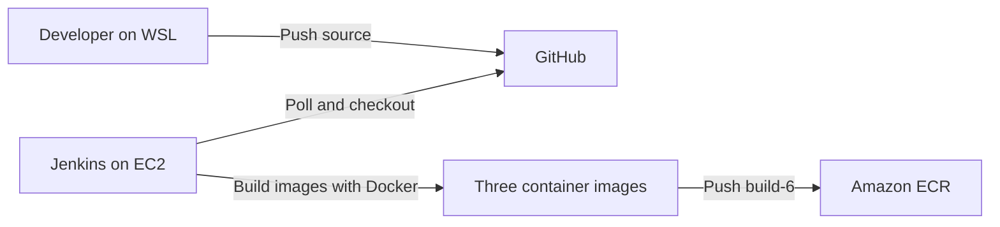
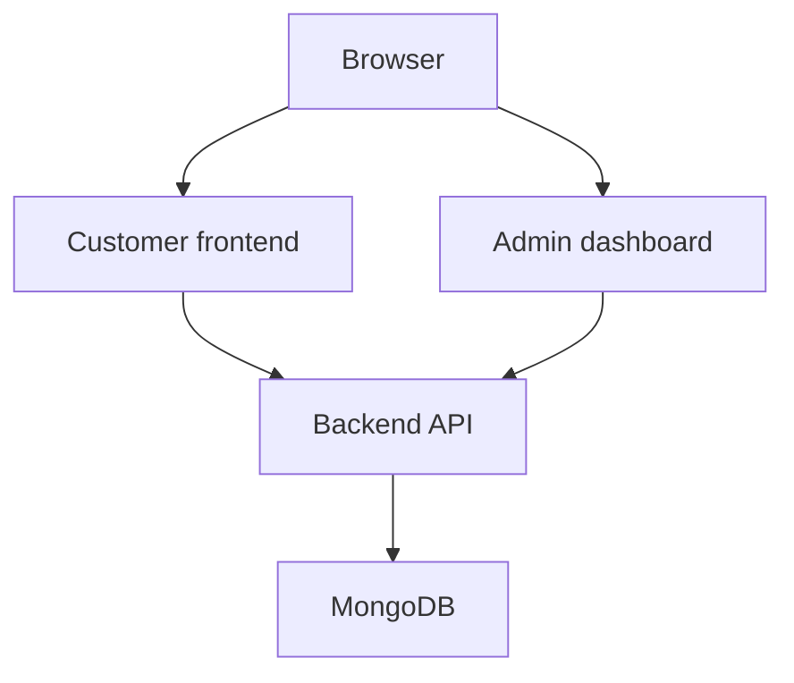
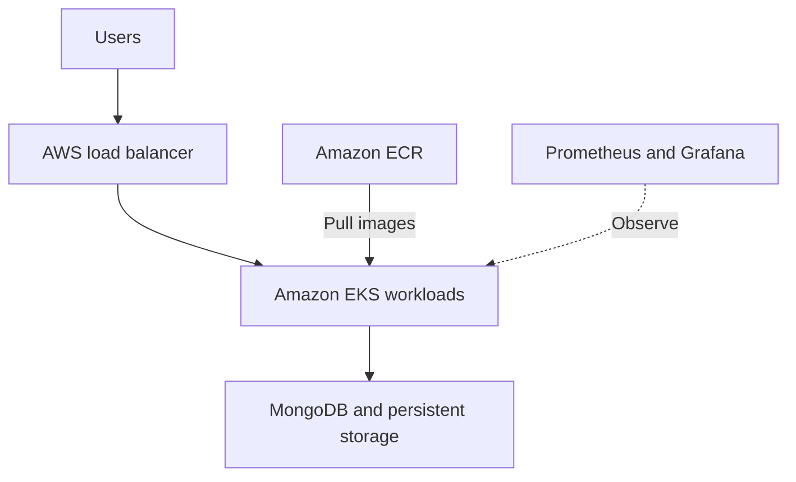

## Sprint 1: Architecture, Docker and Jenkins

This project uses the [ShopNow repository](https://github.com/mouleeswarand/shopNow) to learn how to build and deliver a three-component web application using Docker, Jenkins and AWS. Sprint 1 establishes a working local application and a Jenkins pipeline that builds and pushes images to Amazon Elastic Container Registry (ECR).

> **Status:** The build and ECR push pipeline is working. The AWS EKS architecture below is planned; the cluster, deployment, monitoring and production release are not yet implemented or verified.

## Sprint 1 goals and results

| Goal | Result |
| --- | --- |
| Design an AWS architecture | Initial design prepared; EKS deployment details remain open |
| Containerize the application | Frontend, admin and backend images built and tested locally |
| Store images in ECR | Three private ECR repositories contain `sprint1` and Jenkins tag `build-6` |
| Set up Jenkins on EC2 | Jenkins running on Ubuntu and accessed through Session Manager |
| Grant AWS access | EC2 IAM role verified and used to push images to ECR |
| Integrate GitHub | Repository checkout and Poll SCM configured; manual pipeline build succeeded |
| Connect Jenkins to EKS | Pending creation of the EKS cluster |

## Application components

| Component | Technology | Purpose |
| --- | --- | --- |
| Customer frontend | React and Nginx | Displays the store and products |
| Admin dashboard | React and Nginx | Provides the admin interface |
| Backend | Node.js, Express and Mongoose | Provides the API and connects to MongoDB |
| Database | MongoDB | Stores application data |

## Architecture

### Implemented in Sprint 1



Jenkins runs on an EC2 instance in `ap-south-1`. Its EC2 IAM role supplies temporary AWS credentials. A Session Manager tunnel provides browser access to Jenkins without a public Jenkins port. Jenkins polls GitHub for changes; an automatic build triggered by a new push still needs a separate end-to-end demonstration if build 6 was started manually.

### Local application test



The containers shared the `shopnow-local` Docker network. The backend was exposed only on `127.0.0.1:5000`; the frontend and admin were available on local ports 8080 and 8081. The MongoDB container used for learning has no authentication or persistent volume and must not be used as a production database.

### Planned AWS deployment — not yet implemented



Infrastructure design, ingress and routing, database persistence, EKS access, autoscaling and monitoring will be finalized and validated in later sprints. This is an AWS project; multi-cloud deployment has not been implemented.

## Sprint 1 environment

- Development: Ubuntu Linux on WSL 2, Docker Desktop, Git and AWS CLI v2.
- AWS region: `ap-south-1` (Mumbai).
- Jenkins host: Ubuntu 26.04 LTS on EC2; Java 21 and Docker Engine.
- Jenkins access: AWS Systems Manager Session Manager port forwarding.
- Source control: GitHub, `main` branch.
- Registry: private Amazon ECR.

AWS account IDs, IAM role names and registry URLs are environment-specific. Substitute your own values when recreating the setup. Do not commit credentials, tokens or passwords.

## Work completed

### 1. Inspect and prepare the application

The repository contained `frontend`, `admin` and `backend` directories, each with a Dockerfile and npm lock file. The supplied upstream README referenced Jenkins and scripts directories that were not present in the checkout used for this sprint. A new root `Jenkinsfile` was created for the CI pipeline.

### 2. Build and test images locally

From the repository root:

```bash
docker build --build-arg USER_NAME=mouli -t shopnow-frontend:sprint1 ./frontend
docker build --build-arg USER_NAME=mouli -t shopnow-admin:sprint1 ./admin
docker build -t shopnow-backend:sprint1 ./backend
docker image ls 'shopnow-*'
```

The frontend and admin builds embed the `mouli` URL prefix. Their Nginx configuration was updated to serve `/mouli/` and `/mouli-admin/` and proxy their API paths to `backend-service`. Change both the build argument and Nginx paths together if using a different prefix.

For local testing, MongoDB and the backend were started on a Docker network. The backend was given the network alias `backend-service`, and its `MONGODB_URI` pointed to the local MongoDB container. A successful backend test returned HTTP 200 from `/api/health` and `/api/products`; the database seeded six sample products. The customer and admin pages were confirmed to work locally.

The backend Docker health check was corrected from `/health` to `/api/health`. After rebuilding and recreating the backend container, Docker reported it as **healthy**.

Local test addresses:

- Customer: `http://localhost:8080/mouli/`
- Admin: `http://localhost:8081/mouli-admin/`
- Backend health: `http://localhost:5000/api/health`

These addresses require the corresponding local containers to be running. The local MongoDB data is temporary and can be lost when its container is removed.

### 3. Push images to ECR

Three ECR repositories were created:

```text
mouli-shopnow/frontend
mouli-shopnow/admin
mouli-shopnow/backend
```

Images were tagged and pushed first as `sprint1`, then by Jenkins as `build-6`. A repeatable verification command is:

```bash
for component in frontend admin backend; do
  printf '\n--- %s ---\n' "$component"
  aws ecr list-images \
    --region ap-south-1 \
    --repository-name "mouli-shopnow/$component" \
    --query 'imageIds[*].imageTag' \
    --output table
done
```

ECR login uses a temporary authorization token; the pipeline obtains a fresh token before pushing. Image tags identify builds but can be changed unless tag immutability is configured. For a production deployment, track image digests and define a retention policy.

### 4. Set up Jenkins and AWS access

- Launched a Jenkins EC2 host and connected through AWS Systems Manager Session Manager.
- Installed Java 21, Jenkins, Git, Docker Engine and AWS CLI.
- Configured the EC2 role `shopnow-jenkins-ec2-role` with Systems Manager and scoped ECR image-push permissions.
- Verified the Jenkins user received the EC2 assumed role with `aws sts get-caller-identity`.
- Added the Jenkins operating-system user to the Docker group and restarted the service so its running process received the new group membership.
- Accessed the Jenkins dashboard through a local port-forwarding tunnel on `localhost:8082`.

> Docker group membership provides powerful control over the host. This is a learning setup for trusted jobs; use isolated build agents and appropriate controls for production. The tunnel's localhost URL is not a publicly reachable webhook endpoint.

### 5. Configure the CI pipeline

A Jenkins Pipeline job reads the root `Jenkinsfile` from the GitHub `main` branch. Its stages:

1. **Verify tools** — checks Git, Docker, AWS CLI and the AWS identity.
2. **Build images** — builds the frontend, admin and backend images.
3. **Push images to ECR** — authenticates to ECR and pushes all three images using a Jenkins build-number tag.

**Poll SCM** was configured with `H/5 * * * *`, so Jenkins checks for changes approximately every five minutes. This is polling, not a GitHub webhook. The pipeline currently builds and pushes images; it does not deploy to EKS or run automated application tests.

## Screenshot mapping

Create a `screenshots/` folder in the repository. Save each image using the filename listed below; the Markdown image references will then display on GitHub. If you do not have a screenshot yet, leave it out or remove its reference until it is available. Do not capture passwords, access keys, tokens, session codes or other sensitive information.

| # | Screenshot | Save as | Evidence |
| --- | --- | --- | --- |
| 1 | WSL tools / Docker images | `screenshots/01-local-docker-images.png` | Three local `sprint1` images |
| 2 | Backend API and healthy container | `screenshots/02-backend-health.png` | HTTP 200 and healthy Docker status |
| 3 | Customer application | `screenshots/03-customer-app.png` | Customer page and sample products |
| 4 | Admin application | `screenshots/04-admin-dashboard.png` | Admin dashboard |
| 5 | EC2 instance | `screenshots/05-jenkins-ec2.png` | Jenkins host, running state and region |
| 6 | Jenkins dashboard | `screenshots/06-jenkins-dashboard.png` | Jenkins dashboard after setup |
| 7 | Successful Jenkins build | `screenshots/07-jenkins-build.png` | Build 6 and `SUCCESS` / pipeline stages |
| 8 | ECR image tags | `screenshots/08-ecr-image-tags.png` | Three repositories with `build-6` |
| 9 | Poll SCM configuration or polling log | `screenshots/09-poll-scm.png` | Polling schedule and/or successful check |

## Troubleshooting notes

| Issue | Cause and resolution |
| --- | --- |
| Docker build interrupted with `context canceled` | The build was stopped with Ctrl+C. Re-run it and allow package installation to finish. |
| Backend marked unhealthy while API returned HTTP 200 | Dockerfile checked `/health`; corrected it to `/api/health`, rebuilt the image and recreated the container. |
| GitHub HTTPS authentication failed | GitHub does not accept an account password for Git pushes. Authenticate using GitHub CLI or another supported method. |
| `apt` reported a malformed Docker repository entry | Corrected the repository entry so it appeared on one line with the Ubuntu `resolute` suite. |
| Jenkins pipeline could not access `docker.sock` | The running Jenkins process had not acquired Docker group membership. Restarted Jenkins and verified its process groups. |
| No Jenkins `Build Steps` option | The job was a Pipeline job, so stages were defined in a Jenkinsfile rather than a Freestyle build step. |


 
# 🛒 ShopNow E-Commerce - Kubernetes Learning Project

ShopNow is a **Kubernetes learning project** built around a full-stack MERN e-commerce application:
- **Customer App** (React frontend)  
- **Admin Dashboard** (React admin panel)  
- **Backend API** (Express + MongoDB)  

This project teaches **Kubernetes** from container basics to production-ready deployments with Dockerfiles, Kubernetes manifests, Helm, GitOps and CICD using Jenkins.

## 🎯 Learning Objectives
- Write Dockerfiles for containerising the application
- Master Kubernetes fundamentals through hands-on practice
- Understand and implement HELM Chart for application deployment on kubernetes
- Implement GitOps workflows using ArgoCD
- Implement CICD pipelines using Jenkins

---

## 📁 Project Structure

```
shopNow/
├── backend/               # Node.js API server
├── frontend/              # React customer app
├── admin/                 # React admin dashboard
├── kubernetes
│   ├── k8s-manifests/     # Raw Kubernetes YAML files
│   ├── helm/              # Helm charts for package management
│   │   └── charts/        # Individual charts
│   ├── argocd/            # GitOps deployment configs
│   └── pre-req/           # Cluster prerequisites
├── jenkins/               # Pipeline definitions (CI & CD)       
├── docs/                  # learning resources and guides
└── scripts/               # Automation and utility scripts
```

---

## 🚀 Learning Journey

### Container & Kubernetes Basics
1. **Start Here**: [docs/K8S-CONCEPTS.md](docs/K8S-CONCEPTS.md) - Core concepts explained
2. **Raw Kubernetes Manifests**: `kubernetes/k8s-manifests/`

### Package Management & Automation  
3. **Helm Charts**: `kubernetes/helm/`
4. **CI/CD Pipelines**: `jenkins/`

### GitOps & Production Readiness
5. **ArgoCD GitOps**: `kubernetes/argocd/`


## Getting Started

## 🛠 Prerequisites & Setup

#### 1. Setup Tools**: [docs/TOOLS-SETUP-GUIDE.md](docs/TOOLS-SETUP-GUIDE.md)

#### 2. AWS ECR Registry Setup 
```bash
# Setup AWS credentials first
aws configure
# Enter your AWS Access Key ID, Secret Access Key, region (us-east-1), and output format (json)

# Or use environment variables
export AWS_ACCESS_KEY_ID=your-access-key
export AWS_SECRET_ACCESS_KEY=your-secret-key
export AWS_DEFAULT_REGION=us-east-1

# If above credentials are already set, run below command to verify
aws sts get-caller-identity

# Create ECR repositories either via the aws cli as mentioned below or via console (Has to be done once to create the ECR repo, skip this step when you are rebuilding the docker images):

like:

aws ecr create-repository --repository-name <your-username>-shopnow/frontend --region <region>
aws ecr create-repository --repository-name <your-username>-shopnow/backend --region <region>
aws ecr create-repository --repository-name <your-username>-shopnow/admin --region <region>

# Get login token (run this command everytime as the docker credentials are persisted only on the terminal)
aws ecr get-login-password --region <region> | docker login --username AWS --password-stdin <account-id>.dkr.ecr.<region>.amazonaws.com
```


#### 3. Update Configurations in below mentioned files


## 🔧 Personalization Required

**For Multi-User Kubernetes Clusters**: To avoid conflicts when multiple learners use the same cluster, each user must personalize their deployment with unique identifiers.

**IMPORTANT**: This project contains hardcoded references that you must update with your own values:

3.1. Replace "aryan" with your username in these locations:

  **Ingress Paths** (in both Kubernetes manifests and Helm charts):
   - `kubernetes/k8s-manifests/ingress/ingress-shopnow.yaml`
     - Change `/aryan` to `/<your-username>`
     - Change `/aryan-admin` to `/<your-username>-admin`
   
   - `kubernetes/helm/charts/frontend/values.yaml`
     - Change `path: /aryan` to `path: /<your-username>`
   
   - `kubernetes/helm/charts/admin/values.yaml`
     - Change `path: /aryan-admin` to `path: /<your-username>-admin`


  **Nginx ConfigMaps**
   - All references with 'aryan' to <your-username> in following files:
   - `kubernetes/k8s-manifests/frontend/cm-nginx.yaml`   
   - `kubernetes/k8s-manifests/admin/cm-nginx.yaml`


  **Helm Chart Nginx Configurations**:
   - All references with 'aryan' in the 'nginx.config' section to <your-username> in following files:
   - `kubernetes/helm/charts/frontend/values.yaml` 
   - `kubernetes/helm/charts/admin/values.yaml`

  **Dockerfiles** (Build Arguments):
   - `frontend/Dockerfile`
     - Change `ARG USER_NAME=aryan` to `ARG USER_NAME=<your-username>`
   
   - `admin/Dockerfile`
     - Change `ARG USER_NAME=aryan` to `ARG USER_NAME=<your-username>`

  **Build Script** (optional):
   - `scripts/build-and-push.sh`
     - Update the example usage comments that reference "aryan"

3.2. **ECR Repository Names** - Update to your username:
   - All `kubernetes/k8s-manifests/*/deployment.yaml` files
   - All `kubernetes/helm/charts/*/values.yaml` files
   - All `jenkins\Jenkinsfile.*.*` files
   - Change `shopnow/frontend` to `<your-username>-shopnow/frontend`
   - Change `shopnow/backend` to `<your-username>-shopnow/backend`
   - Change `shopnow/admin` to `<your-username>-shopnow/admin`

3.3. **Update Namespace** on these locations:
  - `kubernetes/k8s-manifests/namespace/namespace.yaml` - Change namespace name
  - All files in `kubernetes/k8s-manifests/*/` - Update namespace references
  - `kubernetes/argocd/apps/*.yaml` - Update destination namespace
  - All kubectl commands in this README - Replace `shopnow-demo` with your namespace

3.4. **Update ArgoCD Repository URL**:
  - In `kubernetes/argocd/umbrella-application.yaml` and all `kubernetes/argocd/apps/*.yaml` files:
  - Change `repoURL: 'https://github.com/aryanm12/shopNow'` 
  - To `repoURL: 'https://github.com/<your-github-username>/<your-repo-name>'`


#### 4. Kubernetes Cluster Access (Make sure to have a running Kubernetes cluster, here is an example to connect with EKS)
```bash
# For EKS cluster
aws eks update-kubeconfig --region <region> --name <your-cluster-name>

# Verify access
kubectl cluster-info
kubectl get nodes
```

Note: All the below mentioned kubectl commands assume that you are working with "shopnow-demo" namespace, update the namespace as per yours where ever you find "shopnow-demo".

#### 5. Docker Registry Secret (Only required for private ECR registry)
**Note**: Skip this step if using public Docker Hub images or public ECR repositories.

```bash
# Create registry secret for private ECR image pulls
kubectl create ns shopnow-demo
kubectl create secret docker-registry ecr-secret --docker-server=<account-id>.dkr.ecr.us-east-1.amazonaws.com --docker-username=AWS --docker-password=$(aws ecr get-login-password --region us-east-1) --namespace=shopnow-demo
```

#### 6. Install Pre-requisites in the Kubernetes Environment (Has to be done once per Kubernetes Cluster)
```bash
# Install metrics server (required for resource monitoring and HPA)
kubectl apply -f kubernetes/pre-req/metrics-server.yaml

# Install ingress-nginx controller (for external access)
# For EKS, other cloud provider will have different file
kubectl apply -f https://raw.githubusercontent.com/kubernetes/ingress-nginx/controller-v1.12.0-beta.0/deploy/static/provider/aws/deploy.yaml

# For local development (minikube/kind/Docker Desktop)
kubectl apply -f https://raw.githubusercontent.com/kubernetes/ingress-nginx/controller-v1.8.1/deploy/static/provider/kind/deploy.yaml

# Verify installations
kubectl get pods -n kube-system
kubectl get pods -n ingress-nginx
kubectl top nodes  # Should work after metrics server is running
kubectl top pods  # Should work after metrics server is running

# To enable Persistent Storage

# First install the EBS CSI driver as an EKS Addon

-> In the EKS Console, open your cluster → go to Add-ons → click Get more add-ons → select Amazon EBS CSI driver → click Next.
-> On the configuration page, Under Pod identity association, choose Create a new IAM role, and the console will auto-attach the AmazonEBSCSIDriverPolicy.
-> Confirm and click Create. The add-on installs, the IAM role is associated with the SA via Pod Identity, and the driver starts running.
-> Verify under Add-ons tab that the EBS CSI driver is active and under Pod identity associations tab you see the SA <-> IAM role mapping.

# Install storage class for persistent volumes
kubectl apply -f kubernetes/pre-req/storageclass-gp3.yaml

# Verify storage class installation
kubectl get storageclass


```


## ⚡ Build and Deploy the micro-services

### 1. Build the docker images and push it to the ECR registry created above

```bash
scripts/build-and-push.sh <account-id>.dkr.ecr.<region>.amazonaws.com/<registry-name> <tag-name-number> <your-username> 

# Example for user 'aryan' with tag 'latest' and ECR registry '975050024946.dkr.ecr.ap-southeast-1.amazonaws.com/shopnow':
./scripts/build-and-push.sh 975050024946.dkr.ecr.ap-southeast-1.amazonaws.com/shopnow latest aryan


```

### 2. Choose Your Deployment Method

**Option A: Raw Kubernetes Manifests**
```bash
kubectl apply -f kubernetes/k8s-manifests/namespace/
kubectl apply -f kubernetes/k8s-manifests/database/
kubectl apply -f kubernetes/k8s-manifests/backend/
kubectl apply -f kubernetes/k8s-manifests/frontend/
kubectl apply -f kubernetes/k8s-manifests/admin/
kubectl apply -f kubernetes/k8s-manifests/ingress/
kubectl apply -f kubernetes/k8s-manifests/daemonsets-example/
```

**Option B: Helm Charts**

```bash
helm upgrade --install mongo kubernetes/helm/charts/mongo -n shopnow-demo --create-namespace
helm upgrade --install backend kubernetes/helm/charts/backend -n shopnow-demo
helm upgrade --install frontend kubernetes/helm/charts/frontend -n shopnow-demo
helm upgrade --install admin kubernetes/helm/charts/admin -n shopnow-demo
```

**Option C: ArgoCD GitOps**
```bash
# Install ArgoCD first
kubectl create namespace argocd
kubectl apply -n argocd -f https://raw.githubusercontent.com/argoproj/argo-cd/stable/manifests/install.yaml

# Create target namespace
kubectl create namespace shopnow-demo

# Deploy applications
kubectl apply -f kubernetes/argocd/umbrella-application.yaml

# Check all ArgoCD application status:
kubectl get applications -n argocd

```

### 3. Create users in MongoDB after the mongodb pods are healthy

```bash

# check the status of the mongo-0 pods 
kubectl get pods -n shopnow-demo

# if mongo-0 pod is healthy, then run following command to create a user for the backend to connect
# user credentials should be same as mentioned in the backend secrets-db.yaml file
# First exex into the pods
kubectl -n shopnow-demo exec -it mongo-0 -- mongosh

# Run below commands
use admin;
db.createUser({
  user: 'shopuser',
  pwd: 'ShopNowPass123',
  roles: [
    { role: 'readWrite', db: 'shopnow' },
    { role: 'dbAdmin', db: 'shopnow' }
  ]
});

exit

# Restart backend deployment
kubectl rollout restart deploy backend -n shopnow-demo
```

### 3. Check the resources deployed

```bash
# Check Pods
kubectl get pods -n shopnow-demo

# Check Deployment
kubectl get deploy -n shopnow-demo

# Check Services
kubectl get svc -n shopnow-demo

# Check daemonsets
kubectl get daemonsets -n shopnow-demo

# Check statefulsets
kubectl get statefulsets -n shopnow-demo

# Check HPA
kubectl get hpa -n shopnow-demo

# Check all of the above at once
kubectl get all -n shopnow-demo

# Check configmaps
kubectl get cm -n shopnow-demo

# Check secrets
kubectl get secrets -n shopnow-demo

# Check ingress
kubectl get ing -n shopnow-demo

# Sequence to debug in case of any issue with the pods
kubectl get pods -n shopnow-demo
kubectl describe pod backend-746cc99cd-cqrgf -n shopnow-demo # Assuming that pod backend-746cc99cd-cqrgf has an error
kubectl logs backend-746cc99cd-cqrgf -n shopnow-demo --previous # If no details are found in the above command or if details like liveness probe failed are coming

```


---

## 🌐 Access the Apps

* **Customer App** → [http://<load-balancer-ip-or-dns>/<your-username>](http://<load-balancer-ip-or-dns>/<your-username>)
* **Admin Dashboard** → [http://<load-balancer-ip-or-dns>/<your-username>-admin](http://<load-balancer-ip-or-dns>/<your-username>-admin)

---

## Additional Notes

**Check the Application Architecture details**: [docs/APPLICATION-ARCHITECTURE.md](docs/APPLICATION-ARCHITECTURE.md)
**Check the Troubleshooting Guide**: [docs/TROUBLESHOOTING.md](docs/TROUBLESHOOTING.md)
---

## 👨‍💻 Author

## K Mohan Krishna

---

