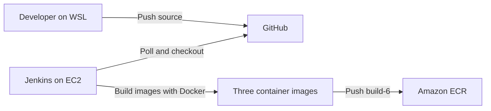
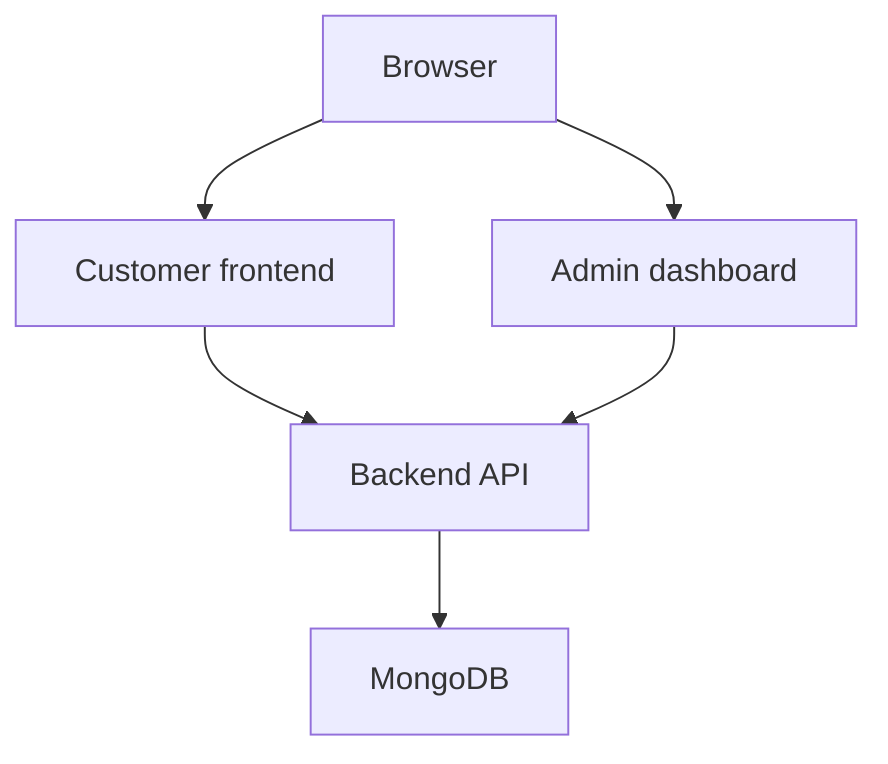
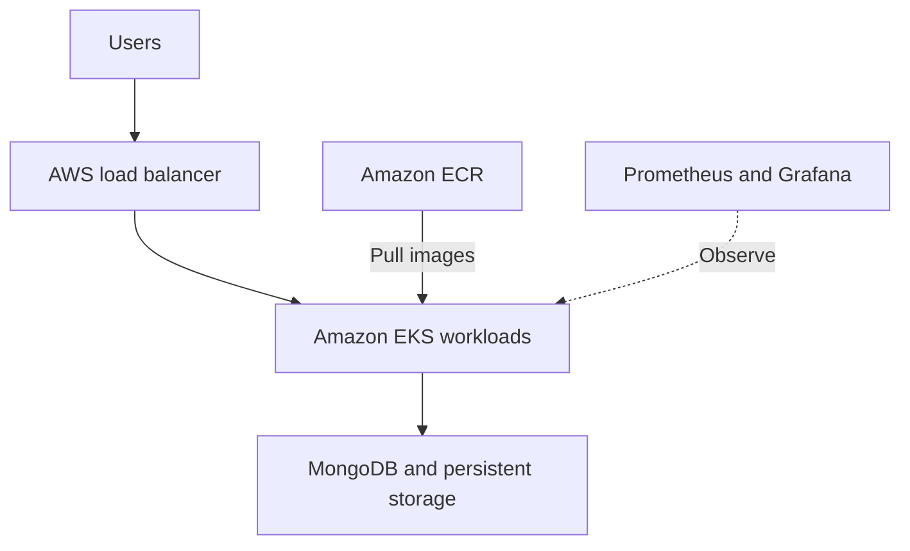
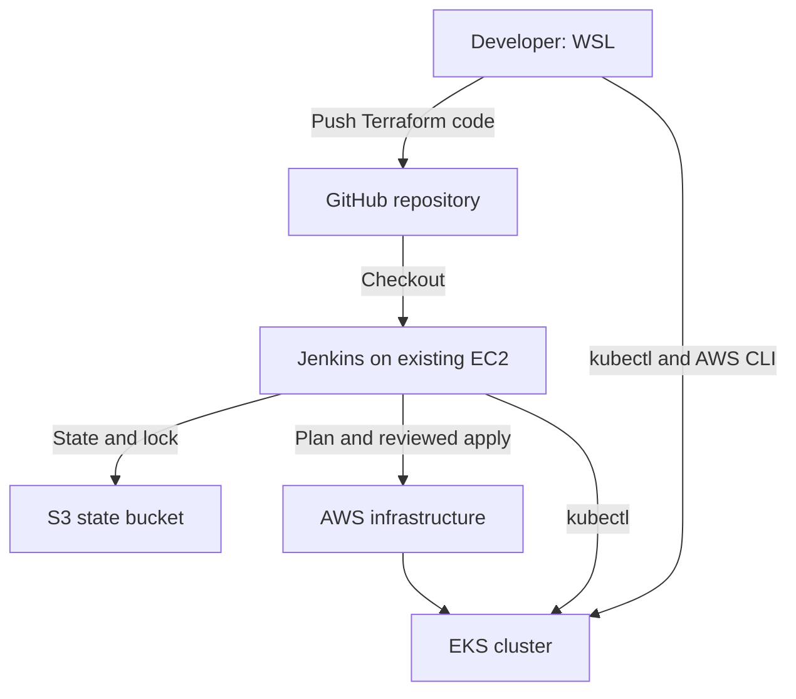
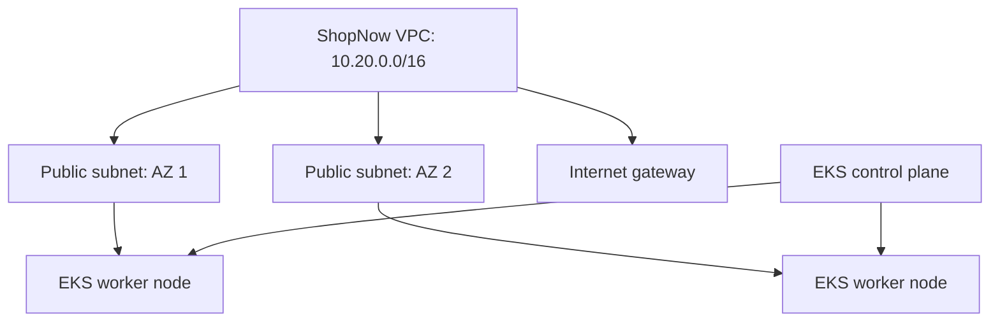
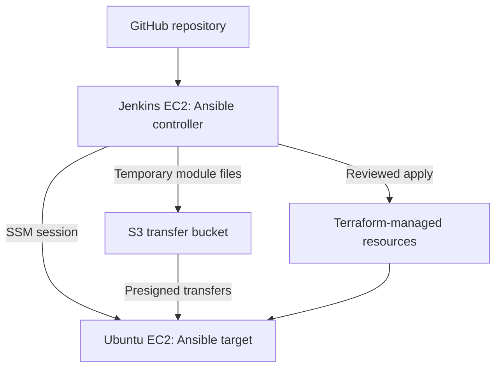

## Sprint 1: Architecture, Docker and Jenkins

This project uses the [ShopNow repository](https://github.com/mouleeswarand/shopNow) to learn how to build and deliver a three-component web application using Docker, Jenkins and AWS. Sprint 1 establishes a working local application and a Jenkins pipeline that builds and pushes images to Amazon Elastic Container Registry (ECR).

> **Status:** The build and ECR push pipeline is working. The AWS EKS architecture below is planned; the cluster, deployment, monitoring and production release are not yet implemented or verified.

## Sprint 1 goals and results

| Goal | Result |
| --- | --- |
| Design an AWS architecture | Initial design prepared; EKS deployment details remain open |
| Containerize the application | Frontend, admin and backend images built and tested locally |
| Store images in ECR | Three private ECR repositories contain `sprint1` and Jenkins tag `build-6` |
| Set up Jenkins on EC2 | Jenkins running on Ubuntu and accessed through Session Manager |
| Grant AWS access | EC2 IAM role verified and used to push images to ECR |
| Integrate GitHub | Repository checkout and Poll SCM configured; manual pipeline build succeeded |
| Connect Jenkins to EKS | Pending creation of the EKS cluster |

## Application components

| Component | Technology | Purpose |
| --- | --- | --- |
| Customer frontend | React and Nginx | Displays the store and products |
| Admin dashboard | React and Nginx | Provides the admin interface |
| Backend | Node.js, Express and Mongoose | Provides the API and connects to MongoDB |
| Database | MongoDB | Stores application data |

## Architecture

### Implemented in Sprint 1



Jenkins runs on an EC2 instance in `ap-south-1`. Its EC2 IAM role supplies temporary AWS credentials. A Session Manager tunnel provides browser access to Jenkins without a public Jenkins port. Jenkins polls GitHub for changes; an automatic build triggered by a new push still needs a separate end-to-end demonstration if build 6 was started manually.

### Local application test



The containers shared the `shopnow-local` Docker network. The backend was exposed only on `127.0.0.1:5000`; the frontend and admin were available on local ports 8080 and 8081. The MongoDB container used for learning has no authentication or persistent volume and must not be used as a production database.

### Planned AWS deployment — not yet implemented



Infrastructure design, ingress and routing, database persistence, EKS access, autoscaling and monitoring will be finalized and validated in later sprints. This is an AWS project; multi-cloud deployment has not been implemented.

## Sprint 1 environment

- Development: Ubuntu Linux on WSL 2, Docker Desktop, Git and AWS CLI v2.
- AWS region: `ap-south-1` (Mumbai).
- Jenkins host: Ubuntu 26.04 LTS on EC2; Java 21 and Docker Engine.
- Jenkins access: AWS Systems Manager Session Manager port forwarding.
- Source control: GitHub, `main` branch.
- Registry: private Amazon ECR.

AWS account IDs, IAM role names and registry URLs are environment-specific. Substitute your own values when recreating the setup. Do not commit credentials, tokens or passwords.

## Work completed

### 1. Inspect and prepare the application

The repository contained `frontend`, `admin` and `backend` directories, each with a Dockerfile and npm lock file. The supplied upstream README referenced Jenkins and scripts directories that were not present in the checkout used for this sprint. A new root `Jenkinsfile` was created for the CI pipeline.

### 2. Build and test images locally

From the repository root:

```bash
docker build --build-arg USER_NAME=mouli -t shopnow-frontend:sprint1 ./frontend
docker build --build-arg USER_NAME=mouli -t shopnow-admin:sprint1 ./admin
docker build -t shopnow-backend:sprint1 ./backend
docker image ls 'shopnow-*'
```

The frontend and admin builds embed the `mouli` URL prefix. Their Nginx configuration was updated to serve `/mouli/` and `/mouli-admin/` and proxy their API paths to `backend-service`. Change both the build argument and Nginx paths together if using a different prefix.

For local testing, MongoDB and the backend were started on a Docker network. The backend was given the network alias `backend-service`, and its `MONGODB_URI` pointed to the local MongoDB container. A successful backend test returned HTTP 200 from `/api/health` and `/api/products`; the database seeded six sample products. The customer and admin pages were confirmed to work locally.

The backend Docker health check was corrected from `/health` to `/api/health`. After rebuilding and recreating the backend container, Docker reported it as **healthy**.

Local test addresses:

- Customer: `http://localhost:8080/mouli/`
- Admin: `http://localhost:8081/mouli-admin/`
- Backend health: `http://localhost:5000/api/health`

These addresses require the corresponding local containers to be running. The local MongoDB data is temporary and can be lost when its container is removed.

### 3. Push images to ECR

Three ECR repositories were created:

```text
mouli-shopnow/frontend
mouli-shopnow/admin
mouli-shopnow/backend
```

Images were tagged and pushed first as `sprint1`, then by Jenkins as `build-6`. A repeatable verification command is:

```bash
for component in frontend admin backend; do
  printf '\n--- %s ---\n' "$component"
  aws ecr list-images \
    --region ap-south-1 \
    --repository-name "mouli-shopnow/$component" \
    --query 'imageIds[*].imageTag' \
    --output table
done
```

ECR login uses a temporary authorization token; the pipeline obtains a fresh token before pushing. Image tags identify builds but can be changed unless tag immutability is configured. For a production deployment, track image digests and define a retention policy.

### 4. Set up Jenkins and AWS access

- Launched a Jenkins EC2 host and connected through AWS Systems Manager Session Manager.
- Installed Java 21, Jenkins, Git, Docker Engine and AWS CLI.
- Configured the EC2 role `shopnow-jenkins-ec2-role` with Systems Manager and scoped ECR image-push permissions.
- Verified the Jenkins user received the EC2 assumed role with `aws sts get-caller-identity`.
- Added the Jenkins operating-system user to the Docker group and restarted the service so its running process received the new group membership.
- Accessed the Jenkins dashboard through a local port-forwarding tunnel on `localhost:8082`.

> Docker group membership provides powerful control over the host. This is a learning setup for trusted jobs; use isolated build agents and appropriate controls for production. The tunnel's localhost URL is not a publicly reachable webhook endpoint.

### 5. Configure the CI pipeline

A Jenkins Pipeline job reads the root `Jenkinsfile` from the GitHub `main` branch. Its stages:

1. **Verify tools** — checks Git, Docker, AWS CLI and the AWS identity.
2. **Build images** — builds the frontend, admin and backend images.
3. **Push images to ECR** — authenticates to ECR and pushes all three images using a Jenkins build-number tag.

**Poll SCM** was configured with `H/5 * * * *`, so Jenkins checks for changes approximately every five minutes. This is polling, not a GitHub webhook. The pipeline currently builds and pushes images; it does not deploy to EKS or run automated application tests.

## Screenshot mapping

Create a `screenshots/` folder in the repository. Save each image using the filename listed below; the Markdown image references will then display on GitHub. If you do not have a screenshot yet, leave it out or remove its reference until it is available. Do not capture passwords, access keys, tokens, session codes or other sensitive information.

| # | Screenshot | Evidence |
| --- | --- | --- | --- |
| 1 | WSL tools / Docker images | Three local `sprint1` images |


| 2 | Backend API and healthy container | HTTP 200 and healthy Docker status |


| 3 | Customer application | Customer page and sample products |


| 4 | Admin application | Admin dashboard |


| 5 | EC2 instance | Jenkins host, running state and region |


| 6 | Jenkins dashboard | Jenkins dashboard after setup |


| 7 | Successful Jenkins build | Build 6 and `SUCCESS` / pipeline stages |


| 8 | ECR image tags | Three repositories with `build-6` |


| 9 | Poll SCM configuration or polling log | Polling schedule and/or successful check |


## Troubleshooting notes

| Issue | Cause and resolution |
| --- | --- |
| Docker build interrupted with `context canceled` | The build was stopped with Ctrl+C. Re-run it and allow package installation to finish. |
| Backend marked unhealthy while API returned HTTP 200 | Dockerfile checked `/health`; corrected it to `/api/health`, rebuilt the image and recreated the container. |
| GitHub HTTPS authentication failed | GitHub does not accept an account password for Git pushes. Authenticate using GitHub CLI or another supported method. |
| `apt` reported a malformed Docker repository entry | Corrected the repository entry so it appeared on one line with the Ubuntu `resolute` suite. |
| Jenkins pipeline could not access `docker.sock` | The running Jenkins process had not acquired Docker group membership. Restarted Jenkins and verified its process groups. |
| No Jenkins `Build Steps` option | The job was a Pipeline job, so stages were defined in a Jenkinsfile rather than a Freestyle build step. |


# Sprint 2 — AWS Infrastructure with Terraform and Jenkins

## Project overview

This sprint provisions a development Kubernetes environment on AWS using Terraform, with Jenkins coordinating infrastructure plans and a reviewed apply. It builds on the Docker, ECR and Jenkins setup completed in Sprint 1.

**Repository:** [mouleeswarand/shopNow](https://github.com/mouleeswarand/shopNow)  
**AWS region:** `ap-south-1` (Mumbai)  
**Environment:** `dev`  
**Cluster:** `shopnow-dev`

> **Scope:** One development environment has been provisioned and verified. Multiple environments, ShopNow application deployment on EKS, production hardening and monitoring are future work.

## Sprint 2 results

| Goal | Evidence |
| --- | --- |
| Prepare Terraform on WSL and Jenkins | Terraform 1.17.0 was verified on Jenkins; the WSL installation was prepared for the same version |
| Store state remotely | An S3 backend was configured with encryption, bucket versioning, public-access blocking and S3 lockfile support |
| Define AWS infrastructure | Terraform configuration describes the VPC, subnets, internet gateway, routing, EKS, node group, IAM roles and access entry |
| Automate provisioning through Jenkins | A separate apply pipeline generated a saved plan, paused for review and applied it |
| Test consistency | A later Jenkins plan reported **No changes** and finished successfully |
| Test EKS access | WSL and a Jenkins job both listed two Ready worker nodes |

The first apply partially succeeded and failed at node-group creation because the Jenkins role lacked `iam:GetRole` for the EKS node-group service-linked role. After the permission was added, a fresh plan showed one resource remaining and a second apply completed successfully.

## Architecture





The EKS control plane is managed by AWS. The managed node group creates and manages EC2 worker nodes. The existing Jenkins EC2 instance and the S3 state bucket were created separately from this Terraform configuration; they are not destroyed automatically when this Terraform project is destroyed.

The diagram shows the infrastructure used in this sprint. It does not indicate that the ShopNow application, a public load balancer, Prometheus or Grafana has been deployed to EKS.

## Infrastructure at a glance

| Component | Configuration |
| --- | --- |
| VPC | `shopnow-dev-vpc`, CIDR `10.20.0.0/16` |
| Subnets | Two public subnets in separate availability zones |
| Internet access | Internet gateway and public route table |
| EKS cluster | `shopnow-dev`; Kubernetes control plane reported version 1.37 |
| Worker nodes | EKS managed node group `shopnow-dev-nodes`; desired 2, minimum 1, maximum 3; `t3.medium` on demand |
| Node storage | 20 GiB configured per node |
| API endpoint | Public and private endpoint enabled; public access restricted to configured Jenkins and WSL IPv4 addresses |
| AWS identities | EC2 Jenkins role for Terraform; explicit EKS access entry for `lab-admin` |
| Terraform state | S3 backend using key `shopnow/dev/terraform.tfstate` and `use_lockfile = true` |

The public endpoint allowlist contains the IP addresses in use during setup. If the WSL internet connection or Jenkins public IP changes, access can fail until the allowed CIDRs are updated through Terraform. Access also depends on IAM authentication and Kubernetes authorization.

## Tools and files

| Item | Purpose |
| --- | --- |
| Terraform | Describes and manages AWS resources |
| AWS CLI | Checks AWS identities, cluster details and S3 settings |
| Jenkins | Runs Terraform plans and reviewed applies |
| kubectl | Communicates with the Kubernetes API |
| `terraform/versions.tf` | Terraform version, AWS provider and S3 backend settings |
| `terraform/main.tf` | AWS provider, VPC, subnets, internet gateway and routing |
| `terraform/eks.tf` | EKS cluster, managed nodes and IAM roles |
| `terraform/access.tf` | EKS access entry and cluster access policy for `lab-admin` |
| `terraform/outputs.tf` | Cluster and VPC outputs |
| `terraform/.terraform.lock.hcl` | Records the selected provider version; commit this file |
| `Jenkinsfile.terraform` | Plan-only Jenkins pipeline |
| `Jenkinsfile.terraform-apply` | Saved-plan, review and apply pipeline |

The Jenkins controller was installed in Sprint 1 and remains outside the Terraform-managed VPC. Its EC2 role supplies temporary AWS credentials. The Jenkins `kubectl` client reported v1.36.1 and successfully accessed the v1.37 cluster.

## Remote state

The state bucket was bootstrapped before Terraform used it as a backend. Its settings were verified:

- S3 bucket versioning: **enabled**.
- S3 public-access blocking: all four settings **enabled**.
- Server-side encryption: **SSE-S3 / AES256**.
- Terraform S3 backend: lockfile enabled with `use_lockfile = true`.
- State path: `shopnow/dev/terraform.tfstate`.
- Jenkins role: permissions for the intended state object and lock object.

State can contain sensitive values. Restrict access to the bucket, do not commit state or saved plans to Git, and do not paste state contents into screenshots. Bucket versioning assists recovery; it does not replace access controls or a tested recovery procedure. Locking was configured; any separate concurrency test remains to be performed.

## Terraform and Jenkins workflow

1. **Write and review configuration:** Terraform files describe the desired infrastructure.
2. **Initialize:** `terraform init` configures the backend and downloads the provider.
3. **Validate:** `terraform fmt -check` and `terraform validate` check formatting and configuration.
4. **Plan:** Terraform compares configuration, state and AWS resources. The complete initial plan showed `17 to add, 0 to change, 0 to destroy`.
5. **Review:** The Jenkins apply job paused after creating a saved plan.
6. **Apply:** The operator approved the saved plan in Jenkins. A later run completed the remaining node-group resource after the IAM fix.
7. **Check consistency:** The plan-only job later reported that infrastructure matched the configuration.

The apply job does not run automatically on every push. Its saved plan was removed in its post-build step. Jenkins workspace and console access should be limited because plans and outputs may contain sensitive information. The plan-only and apply jobs are separate; S3 state locking protects shared state during Terraform operations.

## Verification commands

Run these from the WSL environment with the intended AWS identity and region. They are read-only, except `update-kubeconfig`, which updates the local kubeconfig and current Kubernetes context.

### Confirm identity and Terraform version

```bash
aws sts get-caller-identity --region ap-south-1
terraform version
```

### Inspect the EKS cluster and node group

```bash
aws eks describe-cluster \
  --name shopnow-dev \
  --region ap-south-1 \
  --query 'cluster.{Name:name,Status:status,Version:version}' \
  --output table
```

```bash
aws eks describe-nodegroup \
  --cluster-name shopnow-dev \
  --nodegroup-name shopnow-dev-nodes \
  --region ap-south-1 \
  --query 'nodegroup.{Name:nodegroupName,Status:status,Desired:scalingConfig.desiredSize,HealthIssues:health.issues}' \
  --output json
```

### Connect and inspect Kubernetes

```bash
aws eks update-kubeconfig --region ap-south-1 --name shopnow-dev
kubectl get nodes
kubectl get pods -n kube-system
```

Observed results: two worker nodes were `Ready`; `aws-node`, `coredns` and `kube-proxy` pods were running. The separate Jenkins access-check pipeline also listed both nodes as `Ready` and finished successfully.

### Check Terraform consistency

```bash
cd ~/shopNow/terraform
terraform init
terraform fmt -check
terraform validate
terraform plan
```

The Jenkins plan job reported **No changes. Your infrastructure matches the configuration.** A later plan can legitimately differ if code, AWS resources or provider behavior changes; inspect it before any apply.

## Screenshot mapping

Create a folder named `screenshots/sprint-2/` in the repository. Save each screenshot with the exact filename below. The image references beneath the table will render automatically once the screenshots are committed to GitHub. The images are placeholders; add your own captures.

| No. | Screenshot to capture | What it demonstrates |
| --- | --- | --- | --- |
| 1 | Terraform versions on WSL and Jenkins | Terraform is available in both environments |


| 2 | S3 state bucket properties | Versioning, encryption and public-access block |


| 3 | Jenkins full Terraform plan | Initial plan and review step |


| 4 | Jenkins successful apply | Apply completion and successful Jenkins build |


| 5 | EKS cluster overview | Cluster name, region, status and Kubernetes version |
| 6 | EKS node group | Managed node group and status |
| 7 | WSL `kubectl get nodes` | Two Ready nodes |


| 8 | Jenkins drift check | Plan reports no changes and build succeeds |


| 9 | Jenkins EKS access job | Jenkins lists Ready nodes and finishes successfully |


## Troubleshooting

| Symptom | Resolution used |
| --- | --- |
| `terraform: not found` on Jenkins | Installed Terraform on the EC2 instance and verified it as the Jenkins user. |
| Git push rejected as non-fast-forward | Fetched remote changes, rebased the local Terraform commit onto the README commits and pushed again. |
| Node-group creation failed: missing `iam:GetRole` | Granted the Jenkins role read access to the existing EKS service-linked roles; verified access and generated a fresh plan. |
| `sudo: unknown user jenkins` | The command was run on a different machine. Reconnected to Jenkins EC2 through Session Manager and ran it there. |
| Jenkins Docker access denied in Sprint 1 | Restarted Jenkins after adding its user to the Docker group, then checked the running process groups. |

If an apply fails, inspect the error and generate a fresh plan. Terraform may have already created some resources and updated remote state. Do not delete the state bucket to fix an apply error.

## Security, cost and lifecycle notes

- The EKS API public endpoint is restricted to the configured IP addresses, but the nodes are in public subnets. Review network design and hardening before production use.
- The `lab-admin` EKS access entry grants full cluster administrator access. The Jenkins cluster creator also has bootstrap administrator access. Review and narrow privileges for production.
- The lab Jenkins provisioning policy includes broad regional EC2 and EKS permissions. Jenkins jobs, the Docker socket and IAM role are sensitive; limit access to trusted users and tighten permissions.
- The EKS CNI policy is attached to the node role in this learning setup; a workload-specific identity should be evaluated for a production design.
- The cluster, worker nodes, storage, public IPv4 addresses, Jenkins instance, ECR and other AWS resources can incur charges. A single `dev` environment remains running through Sprint 6.
- After Sprint 6, review and destroy Terraform-managed resources using a reviewed plan. Retain the S3 state bucket until the destroy is complete and AWS resources are verified removed. Jenkins, the state bucket and Sprint 1 resources were created separately and need separate cleanup.


# Sprint 3 — Configuration Management with Ansible and Jenkins

## Project overview

This sprint adds Ansible configuration management to the [ShopNow DevOps project](https://github.com/mouleeswarand/shopNow). Jenkins runs Ansible against a dedicated Terraform-managed Ubuntu EC2 instance through AWS Systems Manager (SSM). A successful Terraform apply then triggers the Ansible job.

**Region:** `ap-south-1` (Mumbai)  
**Environment:** `dev`  
**Target:** `shopnow-dev-ansible-target`  
**Status:** The target was configured and the Terraform-to-Ansible workflow completed successfully.

## Sprint 3 results

| Goal | Verified result |
| --- | --- |
| Install Ansible on Jenkins | Ansible Core 2.20.1 and the `amazon.aws` collection were available to the Jenkins user |
| Provision a target with Terraform | Ubuntu EC2 instance created with an SSM role, instance profile and security group |
| Connect through Systems Manager | Target reported **Online**; Ansible connectivity test succeeded |
| Configure the target | Playbook installed Docker, `kubectl`, curl and CA certificates; Docker service was enabled and started |
| Test repeatability | Second configuration run reported `changed=0`, `unreachable=0`, `failed=0` |
| Integrate with Jenkins | Terraform apply pipeline triggered `shopnow-ansible #6`; both jobs finished **SUCCESS** |

This sprint configures a separate EC2 instance. EKS-managed worker nodes were not configured with Ansible; EKS can replace those nodes, making manual node changes unsuitable as a lasting configuration method.

## Architecture



The Jenkins server acts as the **control node**, meaning it runs the Ansible playbooks. The target is the EC2 server that receives the configuration. The connection uses Systems Manager; the target security group has no inbound SSH rule. The S3 bucket is used for temporary Ansible transfers and is separate from the Terraform state bucket.

## Components and files

| Component or file | Purpose |
| --- | --- |
| `terraform/ansible-target.tf` | Defines the target instance, role, instance profile, security group and output |
| `ansible/inventory.ini` | Defines the target instance and SSM connection settings |
| `ansible/connectivity.yml` | Checks Ansible connectivity using the ping module |
| `ansible/configure-server.yml` | Installs Docker, kubectl and supporting packages |
| `Jenkinsfile.ansible` | Runs syntax, connectivity and configuration stages |
| `Jenkinsfile.terraform-apply` | Plans, pauses for review, applies and triggers Ansible after success |
| S3 transfer bucket | Holds temporary files used by the SSM connection plugin |

The inventory and Jenkins SSM permission currently reference a fixed EC2 instance ID. If Terraform replaces that instance, both must be updated before Ansible can connect. Dynamic discovery has not yet been implemented.

## Implementation

### 1. Prepare the Jenkins control node

Ansible was installed on the existing Jenkins Ubuntu server. The Jenkins operating-system user was verified to have access to:

- Ansible Core `2.20.1` and `ansible-playbook`.
- The `amazon.aws` collection, version `10.1.2` at the time of the test.
- AWS Python libraries `boto3` and `botocore`.
- The AWS Session Manager plugin and AWS CLI.

The EC2 instance role provides AWS credentials; no access keys were entered into the Jenkins job. Jenkins already has powerful Docker and infrastructure permissions in this lab, so access to the controller, jobs and repository must be limited to trusted users.

### 2. Provision the target

Terraform described five additions: an EC2 IAM role, its SSM policy attachment, an instance profile, a security group and an EC2 instance. The plan showed `5 to add, 0 to change, 0 to destroy`, and Jenkins applied the reviewed plan successfully.

The target uses Ubuntu Server 24.04 LTS, a `t3.small` instance, a 20 GiB encrypted gp3 root volume, IMDSv2 and a public subnet. It has no inbound security-group rules; outbound access is used for Systems Manager and package downloads. A fixed, verified AMI ID was used to avoid an unreviewed replacement when a new image is released.

The instance was reported as **running** by EC2 and **Online** by Systems Manager. The target IAM role uses `AmazonSSMManagedInstanceCore` to register with Systems Manager.

### 3. Configure SSM file transfers

The Ansible SSM connection plugin needs the controller and target to reach S3. The transfer bucket is separate from Terraform state, has all public-access blocks enabled, uses SSE-S3 encryption and has versioning disabled. The Jenkins role received bucket read/write/delete permissions and permission to start a session on the specific target.

Ansible normally deletes transfer files after a playbook run, but an interrupted run may leave files behind. Restrict access to the bucket and avoid sending secrets through tasks that could leave them in temporary files. Bucket access verification confirmed its location; the successful Ansible run verified connectivity and transfers together.

### 4. Test connectivity

The Jenkins pipeline ran `ansible/connectivity.yml`. Its ping task checks that Ansible can connect and run a Python module on the target; it is not an ICMP network ping.

Observed recap:

```text
ok=1  changed=0  unreachable=0  failed=0
Finished: SUCCESS
```

### 5. Configure the server

The configuration playbook uses elevated privileges to:

1. Install Ubuntu's `docker.io`, `curl` and `ca-certificates` packages.
2. Start Docker and enable it at boot.
3. Download `kubectl` v1.37.0 with SHA-256 checksum verification.
4. Display Docker and kubectl client versions.

Installing kubectl does not grant the target access to the EKS cluster. EKS access for this target has not been configured or tested.

The first configuration run succeeded with `ok=7`, `changed=2` and `failed=0`. The second run succeeded with `ok=7`, `changed=0` and `failed=0`, demonstrating repeatability for the tested target and unchanged inputs.

### 6. Chain Jenkins jobs

The apply pipeline generates a Terraform plan, pauses for review, applies the saved plan and, only after a successful apply, starts `shopnow-ansible`. It waits for the downstream job and propagates a downstream failure to the upstream result. The `tfplan` file is removed in the pipeline's post-build step.

The connected workflow was tested successfully: `shopnow-ansible #6` completed with **SUCCESS**, followed by the Terraform apply job finishing **SUCCESS**. The apply job uses a manual review step; it is not an automatic approval of infrastructure changes.

## Verification commands

These commands are for inspection. Use the appropriate AWS identity and avoid exposing credentials or Terraform state.

### Check the target in EC2 and Systems Manager

Replace the example instance ID if Terraform replaces the target:

```bash
aws ec2 describe-instances \
  --region ap-south-1 \
  --instance-ids i-0a1bba312966f8413 \
  --query 'Reservations[0].Instances[0].{ID:InstanceId,State:State.Name}' \
  --output table
```

```bash
aws ssm describe-instance-information \
  --region ap-south-1 \
  --filters 'Key=InstanceIds,Values=i-0a1bba312966f8413' \
  --query 'InstanceInformationList[*].{ID:InstanceId,PingStatus:PingStatus,Platform:PlatformName}' \
  --output table
```

### Check Ansible on Jenkins EC2

```bash
sudo -u jenkins ansible-playbook --version
sudo -u jenkins ansible-galaxy collection list amazon.aws
sudo -u jenkins session-manager-plugin
```

### Verify the playbook through Jenkins

Run `shopnow-ansible` and inspect the **Console Output**. A successful repeat run should show `unreachable=0` and `failed=0`; `changed=0` is expected when the target already matches the playbook. A legitimate package or configuration change can produce a nonzero changed count.

## Screenshot mapping

Create `screenshots/sprint-3/` in the repository and save screenshots using the names below. The image references will display once the files are added to GitHub. These are placeholders: use your own screenshots and redact credentials, tokens, session codes and other sensitive information.

| No. | Screenshot | Evidence |
| --- | --- | --- | --- |
| 1 | Ansible and collection versions | Ansible runs as the Jenkins user |


| 2 | Terraform target plan | Five additions and no changes or deletions |
| 3 | Terraform apply | Target resources created successfully |


| 4 | Systems Manager managed nodes | Target is Online |


| 5 | Transfer bucket security | Encryption and public-access block |


| 6 | Ansible connectivity | Connectivity recap with no failures |
| 7 | First configuration run | Configuration succeeded with changes |
| 8 | Second configuration run | `changed=0` and `failed=0` |


| 9 | Terraform-to-Ansible flow | Downstream Ansible job and upstream job both succeeded |


## Troubleshooting

| Issue | What to check |
| --- | --- |
| `ansible: not found` | Install Ansible on the Jenkins EC2 server, then verify it as the `jenkins` user. |
| `session-manager-plugin: not found` | Install the AWS Session Manager plugin on Jenkins EC2; the WSL installation is separate. |
| `sudo: unknown user jenkins` | Confirm the command is running on the Jenkins EC2 server, not in WSL. |
| Target missing or Offline in Systems Manager | Check EC2 state, the target instance profile, SSM Agent and outbound network access. |
| Ansible SSM `AccessDenied` | Check the Jenkins role, target instance ID and S3 transfer-bucket permissions. The inventory and policy use a fixed ID. |
| Ansible run leaves temporary S3 files | Inspect the transfer bucket after interrupted jobs and remove leftovers according to the lab's retention needs. |


 
# 🛒 ShopNow E-Commerce - Kubernetes Learning Project

ShopNow is a **Kubernetes learning project** built around a full-stack MERN e-commerce application:
- **Customer App** (React frontend)  
- **Admin Dashboard** (React admin panel)  
- **Backend API** (Express + MongoDB)  

This project teaches **Kubernetes** from container basics to production-ready deployments with Dockerfiles, Kubernetes manifests, Helm, GitOps and CICD using Jenkins.

## 🎯 Learning Objectives
- Write Dockerfiles for containerising the application
- Master Kubernetes fundamentals through hands-on practice
- Understand and implement HELM Chart for application deployment on kubernetes
- Implement GitOps workflows using ArgoCD
- Implement CICD pipelines using Jenkins

---

## 📁 Project Structure

```
shopNow/
├── backend/               # Node.js API server
├── frontend/              # React customer app
├── admin/                 # React admin dashboard
├── kubernetes
│   ├── k8s-manifests/     # Raw Kubernetes YAML files
│   ├── helm/              # Helm charts for package management
│   │   └── charts/        # Individual charts
│   ├── argocd/            # GitOps deployment configs
│   └── pre-req/           # Cluster prerequisites
├── jenkins/               # Pipeline definitions (CI & CD)       
├── docs/                  # learning resources and guides
└── scripts/               # Automation and utility scripts
```

---

## 🚀 Learning Journey

### Container & Kubernetes Basics
1. **Start Here**: [docs/K8S-CONCEPTS.md](docs/K8S-CONCEPTS.md) - Core concepts explained
2. **Raw Kubernetes Manifests**: `kubernetes/k8s-manifests/`

### Package Management & Automation  
3. **Helm Charts**: `kubernetes/helm/`
4. **CI/CD Pipelines**: `jenkins/`

### GitOps & Production Readiness
5. **ArgoCD GitOps**: `kubernetes/argocd/`


## Getting Started

## 🛠 Prerequisites & Setup

#### 1. Setup Tools**: [docs/TOOLS-SETUP-GUIDE.md](docs/TOOLS-SETUP-GUIDE.md)

#### 2. AWS ECR Registry Setup 
```bash
# Setup AWS credentials first
aws configure
# Enter your AWS Access Key ID, Secret Access Key, region (us-east-1), and output format (json)

# Or use environment variables
export AWS_ACCESS_KEY_ID=your-access-key
export AWS_SECRET_ACCESS_KEY=your-secret-key
export AWS_DEFAULT_REGION=us-east-1

# If above credentials are already set, run below command to verify
aws sts get-caller-identity

# Create ECR repositories either via the aws cli as mentioned below or via console (Has to be done once to create the ECR repo, skip this step when you are rebuilding the docker images):

like:

aws ecr create-repository --repository-name <your-username>-shopnow/frontend --region <region>
aws ecr create-repository --repository-name <your-username>-shopnow/backend --region <region>
aws ecr create-repository --repository-name <your-username>-shopnow/admin --region <region>

# Get login token (run this command everytime as the docker credentials are persisted only on the terminal)
aws ecr get-login-password --region <region> | docker login --username AWS --password-stdin <account-id>.dkr.ecr.<region>.amazonaws.com
```


#### 3. Update Configurations in below mentioned files


## 🔧 Personalization Required

**For Multi-User Kubernetes Clusters**: To avoid conflicts when multiple learners use the same cluster, each user must personalize their deployment with unique identifiers.

**IMPORTANT**: This project contains hardcoded references that you must update with your own values:

3.1. Replace "aryan" with your username in these locations:

  **Ingress Paths** (in both Kubernetes manifests and Helm charts):
   - `kubernetes/k8s-manifests/ingress/ingress-shopnow.yaml`
     - Change `/aryan` to `/<your-username>`
     - Change `/aryan-admin` to `/<your-username>-admin`
   
   - `kubernetes/helm/charts/frontend/values.yaml`
     - Change `path: /aryan` to `path: /<your-username>`
   
   - `kubernetes/helm/charts/admin/values.yaml`
     - Change `path: /aryan-admin` to `path: /<your-username>-admin`


  **Nginx ConfigMaps**
   - All references with 'aryan' to <your-username> in following files:
   - `kubernetes/k8s-manifests/frontend/cm-nginx.yaml`   
   - `kubernetes/k8s-manifests/admin/cm-nginx.yaml`


  **Helm Chart Nginx Configurations**:
   - All references with 'aryan' in the 'nginx.config' section to <your-username> in following files:
   - `kubernetes/helm/charts/frontend/values.yaml` 
   - `kubernetes/helm/charts/admin/values.yaml`

  **Dockerfiles** (Build Arguments):
   - `frontend/Dockerfile`
     - Change `ARG USER_NAME=aryan` to `ARG USER_NAME=<your-username>`
   
   - `admin/Dockerfile`
     - Change `ARG USER_NAME=aryan` to `ARG USER_NAME=<your-username>`

  **Build Script** (optional):
   - `scripts/build-and-push.sh`
     - Update the example usage comments that reference "aryan"

3.2. **ECR Repository Names** - Update to your username:
   - All `kubernetes/k8s-manifests/*/deployment.yaml` files
   - All `kubernetes/helm/charts/*/values.yaml` files
   - All `jenkins\Jenkinsfile.*.*` files
   - Change `shopnow/frontend` to `<your-username>-shopnow/frontend`
   - Change `shopnow/backend` to `<your-username>-shopnow/backend`
   - Change `shopnow/admin` to `<your-username>-shopnow/admin`

3.3. **Update Namespace** on these locations:
  - `kubernetes/k8s-manifests/namespace/namespace.yaml` - Change namespace name
  - All files in `kubernetes/k8s-manifests/*/` - Update namespace references
  - `kubernetes/argocd/apps/*.yaml` - Update destination namespace
  - All kubectl commands in this README - Replace `shopnow-demo` with your namespace

3.4. **Update ArgoCD Repository URL**:
  - In `kubernetes/argocd/umbrella-application.yaml` and all `kubernetes/argocd/apps/*.yaml` files:
  - Change `repoURL: 'https://github.com/aryanm12/shopNow'` 
  - To `repoURL: 'https://github.com/<your-github-username>/<your-repo-name>'`


#### 4. Kubernetes Cluster Access (Make sure to have a running Kubernetes cluster, here is an example to connect with EKS)
```bash
# For EKS cluster
aws eks update-kubeconfig --region <region> --name <your-cluster-name>

# Verify access
kubectl cluster-info
kubectl get nodes
```

Note: All the below mentioned kubectl commands assume that you are working with "shopnow-demo" namespace, update the namespace as per yours where ever you find "shopnow-demo".

#### 5. Docker Registry Secret (Only required for private ECR registry)
**Note**: Skip this step if using public Docker Hub images or public ECR repositories.

```bash
# Create registry secret for private ECR image pulls
kubectl create ns shopnow-demo
kubectl create secret docker-registry ecr-secret --docker-server=<account-id>.dkr.ecr.us-east-1.amazonaws.com --docker-username=AWS --docker-password=$(aws ecr get-login-password --region us-east-1) --namespace=shopnow-demo
```

#### 6. Install Pre-requisites in the Kubernetes Environment (Has to be done once per Kubernetes Cluster)
```bash
# Install metrics server (required for resource monitoring and HPA)
kubectl apply -f kubernetes/pre-req/metrics-server.yaml

# Install ingress-nginx controller (for external access)
# For EKS, other cloud provider will have different file
kubectl apply -f https://raw.githubusercontent.com/kubernetes/ingress-nginx/controller-v1.12.0-beta.0/deploy/static/provider/aws/deploy.yaml

# For local development (minikube/kind/Docker Desktop)
kubectl apply -f https://raw.githubusercontent.com/kubernetes/ingress-nginx/controller-v1.8.1/deploy/static/provider/kind/deploy.yaml

# Verify installations
kubectl get pods -n kube-system
kubectl get pods -n ingress-nginx
kubectl top nodes  # Should work after metrics server is running
kubectl top pods  # Should work after metrics server is running

# To enable Persistent Storage

# First install the EBS CSI driver as an EKS Addon

-> In the EKS Console, open your cluster → go to Add-ons → click Get more add-ons → select Amazon EBS CSI driver → click Next.
-> On the configuration page, Under Pod identity association, choose Create a new IAM role, and the console will auto-attach the AmazonEBSCSIDriverPolicy.
-> Confirm and click Create. The add-on installs, the IAM role is associated with the SA via Pod Identity, and the driver starts running.
-> Verify under Add-ons tab that the EBS CSI driver is active and under Pod identity associations tab you see the SA <-> IAM role mapping.

# Install storage class for persistent volumes
kubectl apply -f kubernetes/pre-req/storageclass-gp3.yaml

# Verify storage class installation
kubectl get storageclass


```


## ⚡ Build and Deploy the micro-services

### 1. Build the docker images and push it to the ECR registry created above

```bash
scripts/build-and-push.sh <account-id>.dkr.ecr.<region>.amazonaws.com/<registry-name> <tag-name-number> <your-username> 

# Example for user 'aryan' with tag 'latest' and ECR registry '975050024946.dkr.ecr.ap-southeast-1.amazonaws.com/shopnow':
./scripts/build-and-push.sh 975050024946.dkr.ecr.ap-southeast-1.amazonaws.com/shopnow latest aryan


```

### 2. Choose Your Deployment Method

**Option A: Raw Kubernetes Manifests**
```bash
kubectl apply -f kubernetes/k8s-manifests/namespace/
kubectl apply -f kubernetes/k8s-manifests/database/
kubectl apply -f kubernetes/k8s-manifests/backend/
kubectl apply -f kubernetes/k8s-manifests/frontend/
kubectl apply -f kubernetes/k8s-manifests/admin/
kubectl apply -f kubernetes/k8s-manifests/ingress/
kubectl apply -f kubernetes/k8s-manifests/daemonsets-example/
```

**Option B: Helm Charts**

```bash
helm upgrade --install mongo kubernetes/helm/charts/mongo -n shopnow-demo --create-namespace
helm upgrade --install backend kubernetes/helm/charts/backend -n shopnow-demo
helm upgrade --install frontend kubernetes/helm/charts/frontend -n shopnow-demo
helm upgrade --install admin kubernetes/helm/charts/admin -n shopnow-demo
```

**Option C: ArgoCD GitOps**
```bash
# Install ArgoCD first
kubectl create namespace argocd
kubectl apply -n argocd -f https://raw.githubusercontent.com/argoproj/argo-cd/stable/manifests/install.yaml

# Create target namespace
kubectl create namespace shopnow-demo

# Deploy applications
kubectl apply -f kubernetes/argocd/umbrella-application.yaml

# Check all ArgoCD application status:
kubectl get applications -n argocd

```

### 3. Create users in MongoDB after the mongodb pods are healthy

```bash

# check the status of the mongo-0 pods 
kubectl get pods -n shopnow-demo

# if mongo-0 pod is healthy, then run following command to create a user for the backend to connect
# user credentials should be same as mentioned in the backend secrets-db.yaml file
# First exex into the pods
kubectl -n shopnow-demo exec -it mongo-0 -- mongosh

# Run below commands
use admin;
db.createUser({
  user: 'shopuser',
  pwd: 'ShopNowPass123',
  roles: [
    { role: 'readWrite', db: 'shopnow' },
    { role: 'dbAdmin', db: 'shopnow' }
  ]
});

exit

# Restart backend deployment
kubectl rollout restart deploy backend -n shopnow-demo
```

### 3. Check the resources deployed

```bash
# Check Pods
kubectl get pods -n shopnow-demo

# Check Deployment
kubectl get deploy -n shopnow-demo

# Check Services
kubectl get svc -n shopnow-demo

# Check daemonsets
kubectl get daemonsets -n shopnow-demo

# Check statefulsets
kubectl get statefulsets -n shopnow-demo

# Check HPA
kubectl get hpa -n shopnow-demo

# Check all of the above at once
kubectl get all -n shopnow-demo

# Check configmaps
kubectl get cm -n shopnow-demo

# Check secrets
kubectl get secrets -n shopnow-demo

# Check ingress
kubectl get ing -n shopnow-demo

# Sequence to debug in case of any issue with the pods
kubectl get pods -n shopnow-demo
kubectl describe pod backend-746cc99cd-cqrgf -n shopnow-demo # Assuming that pod backend-746cc99cd-cqrgf has an error
kubectl logs backend-746cc99cd-cqrgf -n shopnow-demo --previous # If no details are found in the above command or if details like liveness probe failed are coming

```


---

## 🌐 Access the Apps

* **Customer App** → [http://<load-balancer-ip-or-dns>/<your-username>](http://<load-balancer-ip-or-dns>/<your-username>)
* **Admin Dashboard** → [http://<load-balancer-ip-or-dns>/<your-username>-admin](http://<load-balancer-ip-or-dns>/<your-username>-admin)

---

## Additional Notes

**Check the Application Architecture details**: [docs/APPLICATION-ARCHITECTURE.md](docs/APPLICATION-ARCHITECTURE.md)
**Check the Troubleshooting Guide**: [docs/TROUBLESHOOTING.md](docs/TROUBLESHOOTING.md)
---

## 👨‍💻 Author

## K Mohan Krishna

---

