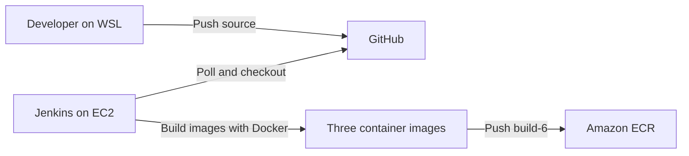
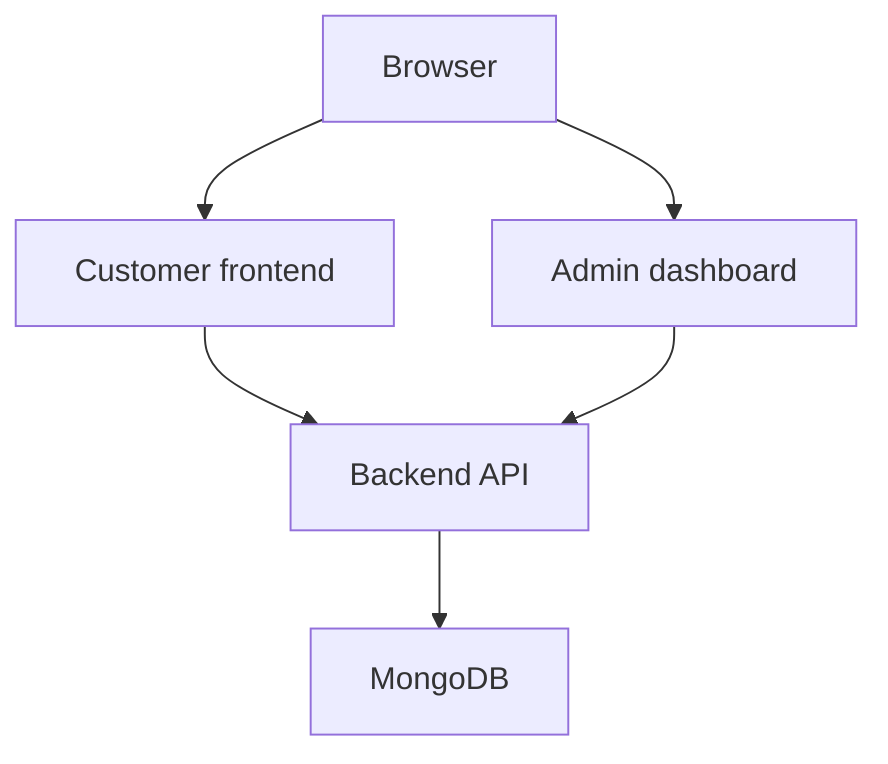
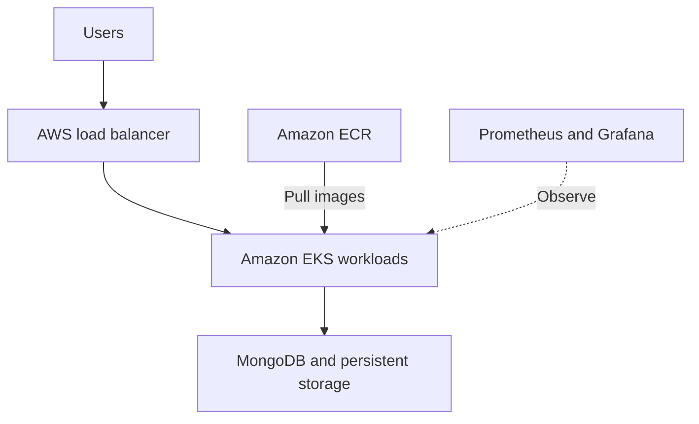
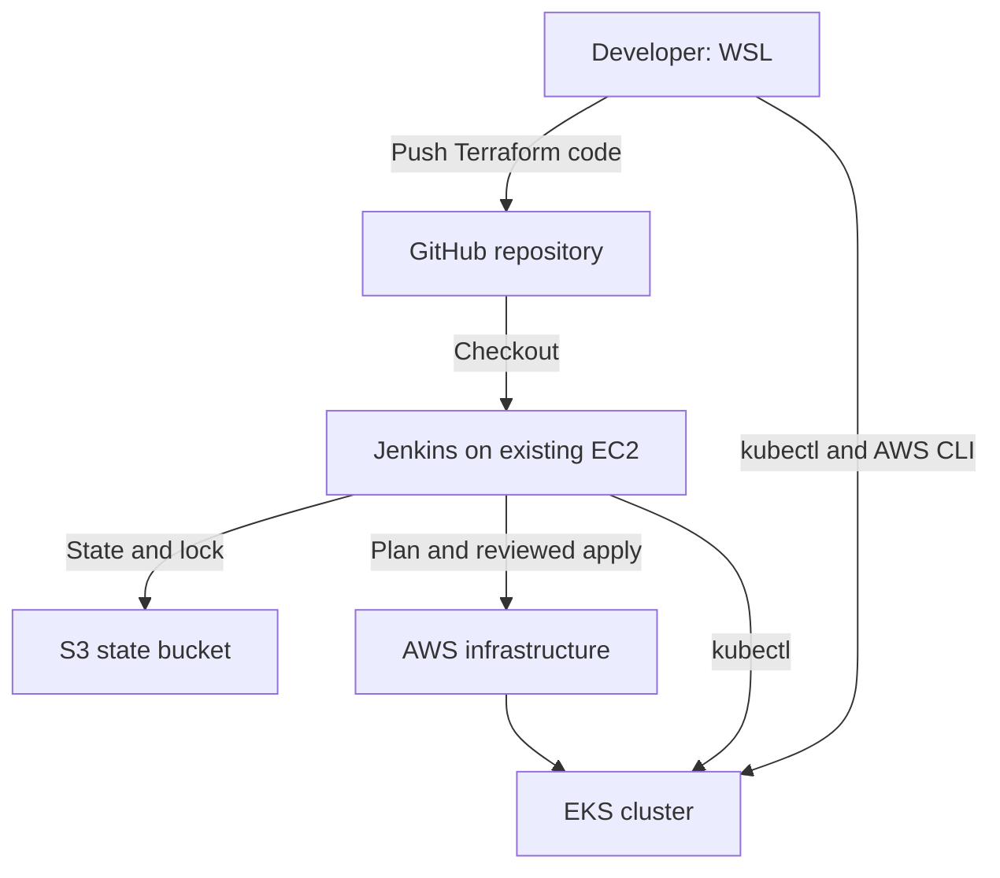
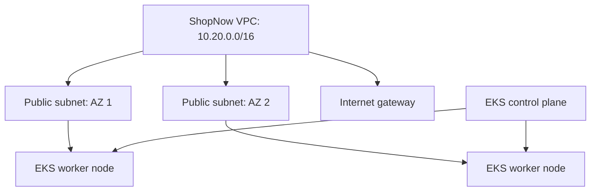
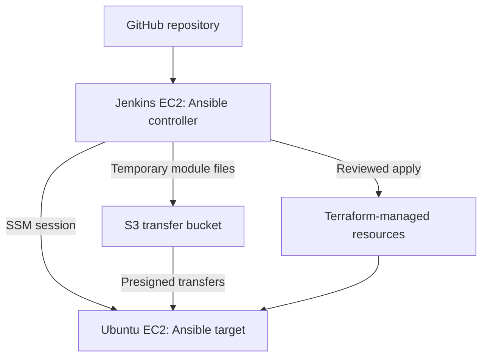
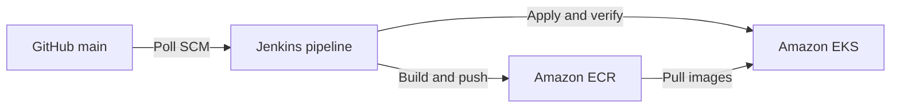
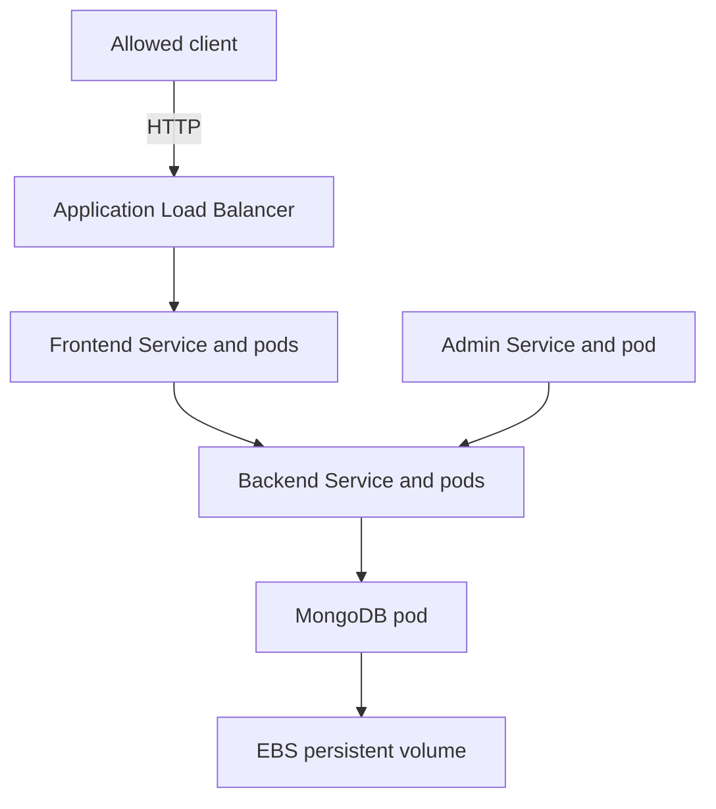
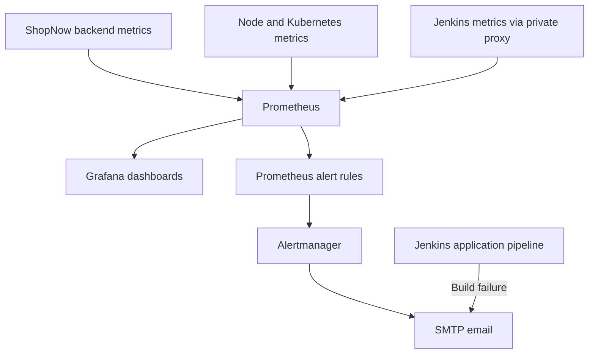

## Sprint 1: Architecture, Docker and Jenkins

This project uses the [ShopNow repository](https://github.com/mouleeswarand/shopNow) to learn how to build and deliver a three-component web application using Docker, Jenkins and AWS. Sprint 1 establishes a working local application and a Jenkins pipeline that builds and pushes images to Amazon Elastic Container Registry (ECR).

> **Status:** The build and ECR push pipeline is working. The AWS EKS architecture below is planned; the cluster, deployment, monitoring and production release are not yet implemented or verified.

## Sprint 1 goals and results

| Goal | Result |
| --- | --- |
| Design an AWS architecture | Initial design prepared; EKS deployment details remain open |
| Containerize the application | Frontend, admin and backend images built and tested locally |
| Store images in ECR | Three private ECR repositories contain `sprint1` and Jenkins tag `build-6` |
| Set up Jenkins on EC2 | Jenkins running on Ubuntu and accessed through Session Manager |
| Grant AWS access | EC2 IAM role verified and used to push images to ECR |
| Integrate GitHub | Repository checkout and Poll SCM configured; manual pipeline build succeeded |
| Connect Jenkins to EKS | Pending creation of the EKS cluster |

## Application components

| Component | Technology | Purpose |
| --- | --- | --- |
| Customer frontend | React and Nginx | Displays the store and products |
| Admin dashboard | React and Nginx | Provides the admin interface |
| Backend | Node.js, Express and Mongoose | Provides the API and connects to MongoDB |
| Database | MongoDB | Stores application data |

## Architecture

### Implemented in Sprint 1



Jenkins runs on an EC2 instance in `ap-south-1`. Its EC2 IAM role supplies temporary AWS credentials. A Session Manager tunnel provides browser access to Jenkins without a public Jenkins port. Jenkins polls GitHub for changes; an automatic build triggered by a new push still needs a separate end-to-end demonstration if build 6 was started manually.

### Local application test



The containers shared the `shopnow-local` Docker network. The backend was exposed only on `127.0.0.1:5000`; the frontend and admin were available on local ports 8080 and 8081. The MongoDB container used for learning has no authentication or persistent volume and must not be used as a production database.

### Planned AWS deployment — not yet implemented



Infrastructure design, ingress and routing, database persistence, EKS access, autoscaling and monitoring will be finalized and validated in later sprints. This is an AWS project; multi-cloud deployment has not been implemented.

## Sprint 1 environment

- Development: Ubuntu Linux on WSL 2, Docker Desktop, Git and AWS CLI v2.
- AWS region: `ap-south-1` (Mumbai).
- Jenkins host: Ubuntu 26.04 LTS on EC2; Java 21 and Docker Engine.
- Jenkins access: AWS Systems Manager Session Manager port forwarding.
- Source control: GitHub, `main` branch.
- Registry: private Amazon ECR.

AWS account IDs, IAM role names and registry URLs are environment-specific. Substitute your own values when recreating the setup. Do not commit credentials, tokens or passwords.

## Work completed

### 1. Inspect and prepare the application

The repository contained `frontend`, `admin` and `backend` directories, each with a Dockerfile and npm lock file. The supplied upstream README referenced Jenkins and scripts directories that were not present in the checkout used for this sprint. A new root `Jenkinsfile` was created for the CI pipeline.

### 2. Build and test images locally

From the repository root:

```bash
docker build --build-arg USER_NAME=mouli -t shopnow-frontend:sprint1 ./frontend
docker build --build-arg USER_NAME=mouli -t shopnow-admin:sprint1 ./admin
docker build -t shopnow-backend:sprint1 ./backend
docker image ls 'shopnow-*'
```

The frontend and admin builds embed the `mouli` URL prefix. Their Nginx configuration was updated to serve `/mouli/` and `/mouli-admin/` and proxy their API paths to `backend-service`. Change both the build argument and Nginx paths together if using a different prefix.

For local testing, MongoDB and the backend were started on a Docker network. The backend was given the network alias `backend-service`, and its `MONGODB_URI` pointed to the local MongoDB container. A successful backend test returned HTTP 200 from `/api/health` and `/api/products`; the database seeded six sample products. The customer and admin pages were confirmed to work locally.

The backend Docker health check was corrected from `/health` to `/api/health`. After rebuilding and recreating the backend container, Docker reported it as **healthy**.

Local test addresses:

- Customer: `http://localhost:8080/mouli/`
- Admin: `http://localhost:8081/mouli-admin/`
- Backend health: `http://localhost:5000/api/health`

These addresses require the corresponding local containers to be running. The local MongoDB data is temporary and can be lost when its container is removed.

### 3. Push images to ECR

Three ECR repositories were created:

```text
mouli-shopnow/frontend
mouli-shopnow/admin
mouli-shopnow/backend
```

Images were tagged and pushed first as `sprint1`, then by Jenkins as `build-6`. A repeatable verification command is:

```bash
for component in frontend admin backend; do
  printf '\n--- %s ---\n' "$component"
  aws ecr list-images \
    --region ap-south-1 \
    --repository-name "mouli-shopnow/$component" \
    --query 'imageIds[*].imageTag' \
    --output table
done
```

ECR login uses a temporary authorization token; the pipeline obtains a fresh token before pushing. Image tags identify builds but can be changed unless tag immutability is configured. For a production deployment, track image digests and define a retention policy.

### 4. Set up Jenkins and AWS access

- Launched a Jenkins EC2 host and connected through AWS Systems Manager Session Manager.
- Installed Java 21, Jenkins, Git, Docker Engine and AWS CLI.
- Configured the EC2 role `shopnow-jenkins-ec2-role` with Systems Manager and scoped ECR image-push permissions.
- Verified the Jenkins user received the EC2 assumed role with `aws sts get-caller-identity`.
- Added the Jenkins operating-system user to the Docker group and restarted the service so its running process received the new group membership.
- Accessed the Jenkins dashboard through a local port-forwarding tunnel on `localhost:8082`.

> Docker group membership provides powerful control over the host. This is a learning setup for trusted jobs; use isolated build agents and appropriate controls for production. The tunnel's localhost URL is not a publicly reachable webhook endpoint.

### 5. Configure the CI pipeline

A Jenkins Pipeline job reads the root `Jenkinsfile` from the GitHub `main` branch. Its stages:

1. **Verify tools** — checks Git, Docker, AWS CLI and the AWS identity.
2. **Build images** — builds the frontend, admin and backend images.
3. **Push images to ECR** — authenticates to ECR and pushes all three images using a Jenkins build-number tag.

**Poll SCM** was configured with `H/5 * * * *`, so Jenkins checks for changes approximately every five minutes. This is polling, not a GitHub webhook. The pipeline currently builds and pushes images; it does not deploy to EKS or run automated application tests.

## Screenshot mapping

Create a `screenshots/` folder in the repository. Save each image using the filename listed below; the Markdown image references will then display on GitHub. If you do not have a screenshot yet, leave it out or remove its reference until it is available. Do not capture passwords, access keys, tokens, session codes or other sensitive information.

| # | Screenshot | Evidence |
| --- | --- | --- | --- |
| 1 | WSL tools / Docker images | Three local `sprint1` images |


| 2 | Backend API and healthy container | HTTP 200 and healthy Docker status |


| 3 | Customer application | Customer page and sample products |


| 4 | Admin application | Admin dashboard |


| 5 | EC2 instance | Jenkins host, running state and region |


| 6 | Jenkins dashboard | Jenkins dashboard after setup |


| 7 | Successful Jenkins build | Build 6 and `SUCCESS` / pipeline stages |


| 8 | ECR image tags | Three repositories with `build-6` |


| 9 | Poll SCM configuration or polling log | Polling schedule and/or successful check |


## Troubleshooting notes

| Issue | Cause and resolution |
| --- | --- |
| Docker build interrupted with `context canceled` | The build was stopped with Ctrl+C. Re-run it and allow package installation to finish. |
| Backend marked unhealthy while API returned HTTP 200 | Dockerfile checked `/health`; corrected it to `/api/health`, rebuilt the image and recreated the container. |
| GitHub HTTPS authentication failed | GitHub does not accept an account password for Git pushes. Authenticate using GitHub CLI or another supported method. |
| `apt` reported a malformed Docker repository entry | Corrected the repository entry so it appeared on one line with the Ubuntu `resolute` suite. |
| Jenkins pipeline could not access `docker.sock` | The running Jenkins process had not acquired Docker group membership. Restarted Jenkins and verified its process groups. |
| No Jenkins `Build Steps` option | The job was a Pipeline job, so stages were defined in a Jenkinsfile rather than a Freestyle build step. |


# Sprint 2 — AWS Infrastructure with Terraform and Jenkins

## Project overview

This sprint provisions a development Kubernetes environment on AWS using Terraform, with Jenkins coordinating infrastructure plans and a reviewed apply. It builds on the Docker, ECR and Jenkins setup completed in Sprint 1.

**Repository:** [mouleeswarand/shopNow](https://github.com/mouleeswarand/shopNow)  
**AWS region:** `ap-south-1` (Mumbai)  
**Environment:** `dev`  
**Cluster:** `shopnow-dev`

> **Scope:** One development environment has been provisioned and verified. Multiple environments, ShopNow application deployment on EKS, production hardening and monitoring are future work.

## Sprint 2 results

| Goal | Evidence |
| --- | --- |
| Prepare Terraform on WSL and Jenkins | Terraform 1.17.0 was verified on Jenkins; the WSL installation was prepared for the same version |
| Store state remotely | An S3 backend was configured with encryption, bucket versioning, public-access blocking and S3 lockfile support |
| Define AWS infrastructure | Terraform configuration describes the VPC, subnets, internet gateway, routing, EKS, node group, IAM roles and access entry |
| Automate provisioning through Jenkins | A separate apply pipeline generated a saved plan, paused for review and applied it |
| Test consistency | A later Jenkins plan reported **No changes** and finished successfully |
| Test EKS access | WSL and a Jenkins job both listed two Ready worker nodes |

The first apply partially succeeded and failed at node-group creation because the Jenkins role lacked `iam:GetRole` for the EKS node-group service-linked role. After the permission was added, a fresh plan showed one resource remaining and a second apply completed successfully.

## Architecture





The EKS control plane is managed by AWS. The managed node group creates and manages EC2 worker nodes. The existing Jenkins EC2 instance and the S3 state bucket were created separately from this Terraform configuration; they are not destroyed automatically when this Terraform project is destroyed.

The diagram shows the infrastructure used in this sprint. It does not indicate that the ShopNow application, a public load balancer, Prometheus or Grafana has been deployed to EKS.

## Infrastructure at a glance

| Component | Configuration |
| --- | --- |
| VPC | `shopnow-dev-vpc`, CIDR `10.20.0.0/16` |
| Subnets | Two public subnets in separate availability zones |
| Internet access | Internet gateway and public route table |
| EKS cluster | `shopnow-dev`; Kubernetes control plane reported version 1.37 |
| Worker nodes | EKS managed node group `shopnow-dev-nodes`; desired 2, minimum 1, maximum 3; `t3.medium` on demand |
| Node storage | 20 GiB configured per node |
| API endpoint | Public and private endpoint enabled; public access restricted to configured Jenkins and WSL IPv4 addresses |
| AWS identities | EC2 Jenkins role for Terraform; explicit EKS access entry for `lab-admin` |
| Terraform state | S3 backend using key `shopnow/dev/terraform.tfstate` and `use_lockfile = true` |

The public endpoint allowlist contains the IP addresses in use during setup. If the WSL internet connection or Jenkins public IP changes, access can fail until the allowed CIDRs are updated through Terraform. Access also depends on IAM authentication and Kubernetes authorization.

## Tools and files

| Item | Purpose |
| --- | --- |
| Terraform | Describes and manages AWS resources |
| AWS CLI | Checks AWS identities, cluster details and S3 settings |
| Jenkins | Runs Terraform plans and reviewed applies |
| kubectl | Communicates with the Kubernetes API |
| `terraform/versions.tf` | Terraform version, AWS provider and S3 backend settings |
| `terraform/main.tf` | AWS provider, VPC, subnets, internet gateway and routing |
| `terraform/eks.tf` | EKS cluster, managed nodes and IAM roles |
| `terraform/access.tf` | EKS access entry and cluster access policy for `lab-admin` |
| `terraform/outputs.tf` | Cluster and VPC outputs |
| `terraform/.terraform.lock.hcl` | Records the selected provider version; commit this file |
| `Jenkinsfile.terraform` | Plan-only Jenkins pipeline |
| `Jenkinsfile.terraform-apply` | Saved-plan, review and apply pipeline |

The Jenkins controller was installed in Sprint 1 and remains outside the Terraform-managed VPC. Its EC2 role supplies temporary AWS credentials. The Jenkins `kubectl` client reported v1.36.1 and successfully accessed the v1.37 cluster.

## Remote state

The state bucket was bootstrapped before Terraform used it as a backend. Its settings were verified:

- S3 bucket versioning: **enabled**.
- S3 public-access blocking: all four settings **enabled**.
- Server-side encryption: **SSE-S3 / AES256**.
- Terraform S3 backend: lockfile enabled with `use_lockfile = true`.
- State path: `shopnow/dev/terraform.tfstate`.
- Jenkins role: permissions for the intended state object and lock object.

State can contain sensitive values. Restrict access to the bucket, do not commit state or saved plans to Git, and do not paste state contents into screenshots. Bucket versioning assists recovery; it does not replace access controls or a tested recovery procedure. Locking was configured; any separate concurrency test remains to be performed.

## Terraform and Jenkins workflow

1. **Write and review configuration:** Terraform files describe the desired infrastructure.
2. **Initialize:** `terraform init` configures the backend and downloads the provider.
3. **Validate:** `terraform fmt -check` and `terraform validate` check formatting and configuration.
4. **Plan:** Terraform compares configuration, state and AWS resources. The complete initial plan showed `17 to add, 0 to change, 0 to destroy`.
5. **Review:** The Jenkins apply job paused after creating a saved plan.
6. **Apply:** The operator approved the saved plan in Jenkins. A later run completed the remaining node-group resource after the IAM fix.
7. **Check consistency:** The plan-only job later reported that infrastructure matched the configuration.

The apply job does not run automatically on every push. Its saved plan was removed in its post-build step. Jenkins workspace and console access should be limited because plans and outputs may contain sensitive information. The plan-only and apply jobs are separate; S3 state locking protects shared state during Terraform operations.

## Verification commands

Run these from the WSL environment with the intended AWS identity and region. They are read-only, except `update-kubeconfig`, which updates the local kubeconfig and current Kubernetes context.

### Confirm identity and Terraform version

```bash
aws sts get-caller-identity --region ap-south-1
terraform version
```

### Inspect the EKS cluster and node group

```bash
aws eks describe-cluster \
  --name shopnow-dev \
  --region ap-south-1 \
  --query 'cluster.{Name:name,Status:status,Version:version}' \
  --output table
```

```bash
aws eks describe-nodegroup \
  --cluster-name shopnow-dev \
  --nodegroup-name shopnow-dev-nodes \
  --region ap-south-1 \
  --query 'nodegroup.{Name:nodegroupName,Status:status,Desired:scalingConfig.desiredSize,HealthIssues:health.issues}' \
  --output json
```

### Connect and inspect Kubernetes

```bash
aws eks update-kubeconfig --region ap-south-1 --name shopnow-dev
kubectl get nodes
kubectl get pods -n kube-system
```

Observed results: two worker nodes were `Ready`; `aws-node`, `coredns` and `kube-proxy` pods were running. The separate Jenkins access-check pipeline also listed both nodes as `Ready` and finished successfully.

### Check Terraform consistency

```bash
cd ~/shopNow/terraform
terraform init
terraform fmt -check
terraform validate
terraform plan
```

The Jenkins plan job reported **No changes. Your infrastructure matches the configuration.** A later plan can legitimately differ if code, AWS resources or provider behavior changes; inspect it before any apply.

## Screenshot mapping

Create a folder named `screenshots/sprint-2/` in the repository. Save each screenshot with the exact filename below. The image references beneath the table will render automatically once the screenshots are committed to GitHub. The images are placeholders; add your own captures.

| No. | Screenshot to capture | What it demonstrates |
| --- | --- | --- | --- |
| 1 | Terraform versions on WSL and Jenkins | Terraform is available in both environments |


| 2 | S3 state bucket properties | Versioning, encryption and public-access block |


| 3 | Jenkins full Terraform plan | Initial plan and review step |


| 4 | Jenkins successful apply | Apply completion and successful Jenkins build |


| 5 | EKS cluster overview | Cluster name, region, status and Kubernetes version |
| 6 | EKS node group | Managed node group and status |
| 7 | WSL `kubectl get nodes` | Two Ready nodes |


| 8 | Jenkins drift check | Plan reports no changes and build succeeds |


| 9 | Jenkins EKS access job | Jenkins lists Ready nodes and finishes successfully |


## Troubleshooting

| Symptom | Resolution used |
| --- | --- |
| `terraform: not found` on Jenkins | Installed Terraform on the EC2 instance and verified it as the Jenkins user. |
| Git push rejected as non-fast-forward | Fetched remote changes, rebased the local Terraform commit onto the README commits and pushed again. |
| Node-group creation failed: missing `iam:GetRole` | Granted the Jenkins role read access to the existing EKS service-linked roles; verified access and generated a fresh plan. |
| `sudo: unknown user jenkins` | The command was run on a different machine. Reconnected to Jenkins EC2 through Session Manager and ran it there. |
| Jenkins Docker access denied in Sprint 1 | Restarted Jenkins after adding its user to the Docker group, then checked the running process groups. |

If an apply fails, inspect the error and generate a fresh plan. Terraform may have already created some resources and updated remote state. Do not delete the state bucket to fix an apply error.

## Security, cost and lifecycle notes

- The EKS API public endpoint is restricted to the configured IP addresses, but the nodes are in public subnets. Review network design and hardening before production use.
- The `lab-admin` EKS access entry grants full cluster administrator access. The Jenkins cluster creator also has bootstrap administrator access. Review and narrow privileges for production.
- The lab Jenkins provisioning policy includes broad regional EC2 and EKS permissions. Jenkins jobs, the Docker socket and IAM role are sensitive; limit access to trusted users and tighten permissions.
- The EKS CNI policy is attached to the node role in this learning setup; a workload-specific identity should be evaluated for a production design.
- The cluster, worker nodes, storage, public IPv4 addresses, Jenkins instance, ECR and other AWS resources can incur charges. A single `dev` environment remains running through Sprint 6.
- After Sprint 6, review and destroy Terraform-managed resources using a reviewed plan. Retain the S3 state bucket until the destroy is complete and AWS resources are verified removed. Jenkins, the state bucket and Sprint 1 resources were created separately and need separate cleanup.


# Sprint 3 — Configuration Management with Ansible and Jenkins

## Project overview

This sprint adds Ansible configuration management to the [ShopNow DevOps project](https://github.com/mouleeswarand/shopNow). Jenkins runs Ansible against a dedicated Terraform-managed Ubuntu EC2 instance through AWS Systems Manager (SSM). A successful Terraform apply then triggers the Ansible job.

**Region:** `ap-south-1` (Mumbai)  
**Environment:** `dev`  
**Target:** `shopnow-dev-ansible-target`  
**Status:** The target was configured and the Terraform-to-Ansible workflow completed successfully.

## Sprint 3 results

| Goal | Verified result |
| --- | --- |
| Install Ansible on Jenkins | Ansible Core 2.20.1 and the `amazon.aws` collection were available to the Jenkins user |
| Provision a target with Terraform | Ubuntu EC2 instance created with an SSM role, instance profile and security group |
| Connect through Systems Manager | Target reported **Online**; Ansible connectivity test succeeded |
| Configure the target | Playbook installed Docker, `kubectl`, curl and CA certificates; Docker service was enabled and started |
| Test repeatability | Second configuration run reported `changed=0`, `unreachable=0`, `failed=0` |
| Integrate with Jenkins | Terraform apply pipeline triggered `shopnow-ansible #6`; both jobs finished **SUCCESS** |

This sprint configures a separate EC2 instance. EKS-managed worker nodes were not configured with Ansible; EKS can replace those nodes, making manual node changes unsuitable as a lasting configuration method.

## Architecture



The Jenkins server acts as the **control node**, meaning it runs the Ansible playbooks. The target is the EC2 server that receives the configuration. The connection uses Systems Manager; the target security group has no inbound SSH rule. The S3 bucket is used for temporary Ansible transfers and is separate from the Terraform state bucket.

## Components and files

| Component or file | Purpose |
| --- | --- |
| `terraform/ansible-target.tf` | Defines the target instance, role, instance profile, security group and output |
| `ansible/inventory.ini` | Defines the target instance and SSM connection settings |
| `ansible/connectivity.yml` | Checks Ansible connectivity using the ping module |
| `ansible/configure-server.yml` | Installs Docker, kubectl and supporting packages |
| `Jenkinsfile.ansible` | Runs syntax, connectivity and configuration stages |
| `Jenkinsfile.terraform-apply` | Plans, pauses for review, applies and triggers Ansible after success |
| S3 transfer bucket | Holds temporary files used by the SSM connection plugin |

The inventory and Jenkins SSM permission currently reference a fixed EC2 instance ID. If Terraform replaces that instance, both must be updated before Ansible can connect. Dynamic discovery has not yet been implemented.

## Implementation

### 1. Prepare the Jenkins control node

Ansible was installed on the existing Jenkins Ubuntu server. The Jenkins operating-system user was verified to have access to:

- Ansible Core `2.20.1` and `ansible-playbook`.
- The `amazon.aws` collection, version `10.1.2` at the time of the test.
- AWS Python libraries `boto3` and `botocore`.
- The AWS Session Manager plugin and AWS CLI.

The EC2 instance role provides AWS credentials; no access keys were entered into the Jenkins job. Jenkins already has powerful Docker and infrastructure permissions in this lab, so access to the controller, jobs and repository must be limited to trusted users.

### 2. Provision the target

Terraform described five additions: an EC2 IAM role, its SSM policy attachment, an instance profile, a security group and an EC2 instance. The plan showed `5 to add, 0 to change, 0 to destroy`, and Jenkins applied the reviewed plan successfully.

The target uses Ubuntu Server 24.04 LTS, a `t3.small` instance, a 20 GiB encrypted gp3 root volume, IMDSv2 and a public subnet. It has no inbound security-group rules; outbound access is used for Systems Manager and package downloads. A fixed, verified AMI ID was used to avoid an unreviewed replacement when a new image is released.

The instance was reported as **running** by EC2 and **Online** by Systems Manager. The target IAM role uses `AmazonSSMManagedInstanceCore` to register with Systems Manager.

### 3. Configure SSM file transfers

The Ansible SSM connection plugin needs the controller and target to reach S3. The transfer bucket is separate from Terraform state, has all public-access blocks enabled, uses SSE-S3 encryption and has versioning disabled. The Jenkins role received bucket read/write/delete permissions and permission to start a session on the specific target.

Ansible normally deletes transfer files after a playbook run, but an interrupted run may leave files behind. Restrict access to the bucket and avoid sending secrets through tasks that could leave them in temporary files. Bucket access verification confirmed its location; the successful Ansible run verified connectivity and transfers together.

### 4. Test connectivity

The Jenkins pipeline ran `ansible/connectivity.yml`. Its ping task checks that Ansible can connect and run a Python module on the target; it is not an ICMP network ping.

Observed recap:

```text
ok=1  changed=0  unreachable=0  failed=0
Finished: SUCCESS
```

### 5. Configure the server

The configuration playbook uses elevated privileges to:

1. Install Ubuntu's `docker.io`, `curl` and `ca-certificates` packages.
2. Start Docker and enable it at boot.
3. Download `kubectl` v1.37.0 with SHA-256 checksum verification.
4. Display Docker and kubectl client versions.

Installing kubectl does not grant the target access to the EKS cluster. EKS access for this target has not been configured or tested.

The first configuration run succeeded with `ok=7`, `changed=2` and `failed=0`. The second run succeeded with `ok=7`, `changed=0` and `failed=0`, demonstrating repeatability for the tested target and unchanged inputs.

### 6. Chain Jenkins jobs

The apply pipeline generates a Terraform plan, pauses for review, applies the saved plan and, only after a successful apply, starts `shopnow-ansible`. It waits for the downstream job and propagates a downstream failure to the upstream result. The `tfplan` file is removed in the pipeline's post-build step.

The connected workflow was tested successfully: `shopnow-ansible #6` completed with **SUCCESS**, followed by the Terraform apply job finishing **SUCCESS**. The apply job uses a manual review step; it is not an automatic approval of infrastructure changes.

## Verification commands

These commands are for inspection. Use the appropriate AWS identity and avoid exposing credentials or Terraform state.

### Check the target in EC2 and Systems Manager

Replace the example instance ID if Terraform replaces the target:

```bash
aws ec2 describe-instances \
  --region ap-south-1 \
  --instance-ids i-0a1bba312966f8413 \
  --query 'Reservations[0].Instances[0].{ID:InstanceId,State:State.Name}' \
  --output table
```

```bash
aws ssm describe-instance-information \
  --region ap-south-1 \
  --filters 'Key=InstanceIds,Values=i-0a1bba312966f8413' \
  --query 'InstanceInformationList[*].{ID:InstanceId,PingStatus:PingStatus,Platform:PlatformName}' \
  --output table
```

### Check Ansible on Jenkins EC2

```bash
sudo -u jenkins ansible-playbook --version
sudo -u jenkins ansible-galaxy collection list amazon.aws
sudo -u jenkins session-manager-plugin
```

### Verify the playbook through Jenkins

Run `shopnow-ansible` and inspect the **Console Output**. A successful repeat run should show `unreachable=0` and `failed=0`; `changed=0` is expected when the target already matches the playbook. A legitimate package or configuration change can produce a nonzero changed count.

## Screenshot mapping

Create `screenshots/sprint-3/` in the repository and save screenshots using the names below. The image references will display once the files are added to GitHub. These are placeholders: use your own screenshots and redact credentials, tokens, session codes and other sensitive information.

| No. | Screenshot | Evidence |
| --- | --- | --- | --- |
| 1 | Ansible and collection versions | Ansible runs as the Jenkins user |


| 2 | Terraform target plan | Five additions and no changes or deletions |
| 3 | Terraform apply | Target resources created successfully |


| 4 | Systems Manager managed nodes | Target is Online |


| 5 | Transfer bucket security | Encryption and public-access block |


| 6 | Ansible connectivity | Connectivity recap with no failures |
| 7 | First configuration run | Configuration succeeded with changes |
| 8 | Second configuration run | `changed=0` and `failed=0` |


| 9 | Terraform-to-Ansible flow | Downstream Ansible job and upstream job both succeeded |


## Troubleshooting

| Issue | What to check |
| --- | --- |
| `ansible: not found` | Install Ansible on the Jenkins EC2 server, then verify it as the `jenkins` user. |
| `session-manager-plugin: not found` | Install the AWS Session Manager plugin on Jenkins EC2; the WSL installation is separate. |
| `sudo: unknown user jenkins` | Confirm the command is running on the Jenkins EC2 server, not in WSL. |
| Target missing or Offline in Systems Manager | Check EC2 state, the target instance profile, SSM Agent and outbound network access. |
| Ansible SSM `AccessDenied` | Check the Jenkins role, target instance ID and S3 transfer-bucket permissions. The inventory and policy use a fixed ID. |
| Ansible run leaves temporary S3 files | Inspect the transfer bucket after interrupted jobs and remove leftovers according to the lab's retention needs. |


# Sprint 4 — CI/CD Deployment of ShopNow to Amazon EKS

## Overview

This sprint deploys the [ShopNow application](https://github.com/mouleeswarand/shopNow) to Amazon EKS using Kubernetes manifests and a Jenkins pipeline. A Git change triggers Jenkins through Poll SCM; Jenkins builds three Docker images, pushes them to Amazon ECR, deploys the workloads and runs basic post-deployment checks.

The customer application is accessible through an AWS Application Load Balancer (ALB) restricted to the lab user's public IP. The admin dashboard remains an internal Kubernetes Service and was tested using port forwarding.

> **Learning environment:** The ALB uses HTTP, the ingress is IP-restricted, MongoDB is a single instance, and the backend uses the lab database administrator credentials. Use sample data only. TLS, application authentication, database least privilege, backups and production hardening remain future work.

## Sprint 4 goals and verified results

| Goal | Result |
| --- | --- |
| Build and push application images | Jenkins built and pushed frontend, admin and backend images to ECR |
| Deploy to EKS | MongoDB and all three application components ran as Kubernetes workloads |
| Persistent storage | A 5 GiB EBS-backed MongoDB claim was Bound; the EBS CSI test volume was independently created, mounted and deleted |
| Health checks | Workload probes and Jenkins rollout checks were configured; application pods became Ready |
| Autoscaling | Metrics Server supplied CPU metrics; a controlled load test increased frontend replicas from one to two |
| End-to-end trigger | A Git push started Jenkins with `Started by an SCM change`; build 10 deployed matching image tags and finished successfully |
| Load balancing | AWS Load Balancer Controller reconciled an ALB Ingress; the customer page displayed products through the ALB |

Only the frontend HPA was demonstrated scaling under load. Backend HPA metrics were valid, but a backend scale-up test was not reported. The current tests are basic checks, not a comprehensive automated test suite.

## Architecture





The ALB routes `/mouli` to the frontend. Frontend Nginx proxies `/mouli/api/` to `backend-service`; admin Nginx proxies `/mouli-admin/api/` to the same backend. The admin dashboard is currently reached using `kubectl port-forward`, not through the ALB. Metrics Server provides CPU data for the frontend and backend HPAs.

## Environment and components

| Component | Implementation |
| --- | --- |
| Region and cluster | `ap-south-1`, EKS cluster `shopnow-dev` |
| Namespace | `shopnow` |
| Images | Private ECR repositories for `frontend`, `admin`, and `backend` |
| Database | MongoDB 7.0, one pod and an internal ClusterIP Service |
| Storage | EBS CSI driver, encrypted `shopnow-gp3` StorageClass, 5 GiB claim |
| Metrics | EKS Metrics Server add-on |
| Scaling | CPU HPAs for frontend and backend, each configured for 1–2 replicas and 70% target utilization |
| Traffic | AWS Load Balancer Controller, ALB Ingress for customer frontend; admin remains internal |
| CI/CD | Jenkins Pipeline, Git polling, Docker, AWS CLI and kubectl |

The MongoDB PVC uses a StorageClass with `reclaimPolicy: Delete`. **Deleting the claim can delete the EBS volume and its data.** Plan backups and cleanup accordingly.

## Repository files

| File | Purpose |
| --- | --- |
| `Jenkinsfile` | Builds, checks, pushes and deploys application images |
| `kubernetes/namespace.yaml` | Creates the `shopnow` namespace |
| `kubernetes/storageclass.yaml` | Defines the encrypted `shopnow-gp3` StorageClass |
| `kubernetes/mongodb.yaml` | Defines the PVC, MongoDB Deployment and internal Service |
| `kubernetes/backend.yaml` | Defines the backend Deployment and internal Service |
| `kubernetes/web.yaml` | Defines frontend and admin Deployments and Services |
| `kubernetes/hpa.yaml` | Defines frontend and backend CPU autoscalers |
| `kubernetes/ingress.yaml` | Routes restricted ALB traffic to the frontend |
| `terraform/addons.tf` | Manages Metrics Server, EBS CSI and its AWS identity resources |
| `terraform/load-balancer-controller.tf` | Manages the load-balancer controller IAM role and policy attachment |
| `terraform/aws-load-balancer-controller-policy.json` | Versioned controller IAM policy document |

The Gateway API CRDs and the AWS Load Balancer Controller were installed with `kubectl` and Helm during this sprint; their lifecycle is not managed by the Terraform files listed above. Record and manage those components separately when rebuilding or cleaning up.

## Implementation journey

### 1. Metrics and EBS storage prerequisites

- Metrics Server EKS add-on `v0.9.0-eksbuild.14` became `ACTIVE`, with two available replicas. `kubectl top nodes` returned CPU and memory usage.
- The EBS CSI add-on `v1.67.2-eksbuild.1` was provisioned with a dedicated IAM role and the EKS cluster's OIDC provider.
- A temporary namespace, PVC and pod verified EBS volume provisioning and file access. The test namespace was removed, the persistent volume disappeared and AWS reported the test EBS volume was no longer found.
- The `shopnow-gp3` StorageClass was retained and committed for application use.

### 2. Database and backend

The `shopnow` namespace and StorageClass were applied. A Kubernetes Secret named `mongodb-credentials` was created manually; it is not in Git. The MongoDB Deployment uses a persistent volume claim and exposes port 27017 through an internal Service. A separate backend Deployment obtains `MONGODB_URI` from the Secret and exposes port 5000 internally.

Verification showed the MongoDB PVC Bound, the backend and database pods Ready, and backend logs reporting a successful database connection and sample-data seeding. Port-forwarded requests to `/api/health` and `/api/products` returned HTTP 200.

**Secret lifecycle:** the pipeline checks for the existing Secret but does not provision or rotate it. A new cluster or namespace needs credentials provisioned securely before deployment. Changing the Secret alone does not rotate MongoDB credentials already initialized on the persistent volume. For production, use a separate least-privileged application database account and a managed secret workflow.

### 3. Frontend, admin and health checks

Frontend and admin Deployments were created with internal ClusterIP Services and HTTP readiness/liveness probes. The backend uses `/api/health`; MongoDB uses TCP probes. The frontend and admin Nginx health endpoint is `/health`.

Through port forwarding, the customer page displayed six products and the admin dashboard opened. Requests through the frontend product route and the admin API health route returned HTTP 200. These checks did not demonstrate an order checkout, order administration or full user acceptance test.

### 4. Horizontal Pod Autoscaling

Metrics Server supplied CPU metrics. Frontend and backend HPAs reported `ScalingActive=True` and `ValidMetricFound`. A temporary bounded request generator drove the frontend HPA from one replica to two. The test Job was removed afterward. The backend HPA was configured and receiving metrics but was not separately demonstrated scaling under load.

The Jenkins deployment does not continuously set frontend or backend replica counts in their manifests, leaving those counts to their HPAs. Pod autoscaling is distinct from scaling the EKS node group; an HPA cannot create capacity if no node has room for its pods.

### 5. Jenkins CI/CD pipeline

The application pipeline:

1. Checks Git, Docker, AWS CLI, kubectl and the Jenkins AWS identity.
2. Builds frontend, admin and backend images tagged with the Jenkins build number.
3. Runs `node --check` for backend JavaScript syntax.
4. Authenticates to ECR and pushes the images.
5. Applies namespace, storage, database, application, HPA and Ingress manifests; renders the application image tags for that build.
6. Waits for database and application rollouts.
7. Tests the frontend product API route and admin health API route from within their pods.

A manual build 9 successfully deployed matching tags, and a later Git change was verified as **Started by an SCM change**. Build 10 deployed `build-10` for all three application images and finished successfully. After the Ingress was added to the pipeline, another Jenkins build succeeded and the customer page was confirmed working.

**Pipeline limitations:** the current image substitution depends on `build-6` strings in the manifests, build-number tags are mutable unless ECR immutability is enforced, and the smoke checks do not replace unit, integration, security or full end-to-end tests. A failed rollout can leave components at different image versions; review pipeline output and Kubernetes state before retrying or rolling back.

### 6. Application Load Balancer

The AWS Load Balancer Controller was installed with Helm chart `1.14.1` (controller `v2.14.1`) using its own IAM role. Gateway API standard CRDs were installed separately. A customer Ingress uses `ingressClassName: alb`, IP targets, health-check path `/health` and an inbound CIDR restricted to the lab user's public IPv4 address.

The ALB reconciled successfully and the customer page displayed products. The first WSL DNS lookup failed while the ALB was active; the page later opened in the browser. The reason for that earlier DNS failure was not established.

The ALB currently listens on HTTP port 80. The IP allowlist may need updating if the client IP changes. The admin dashboard remains internal; do not expose it publicly without authentication, TLS and suitable security controls.

## Verification commands

Use the correct cluster and AWS identity. These commands inspect the deployed state; port forwarding runs until stopped with Ctrl+C.

```bash
kubectl get pods,svc,pvc,hpa -n shopnow
kubectl get ingress shopnow-frontend -n shopnow
kubectl top nodes
```

```bash
kubectl get deployment backend frontend admin -n shopnow \
  -o custom-columns=NAME:.metadata.name,IMAGE:.spec.template.spec.containers[0].image,READY:.status.readyReplicas
```

```bash
kubectl rollout status deployment/backend -n shopnow --timeout=300s
kubectl rollout status deployment/frontend -n shopnow --timeout=300s
kubectl rollout status deployment/admin -n shopnow --timeout=300s
```

```bash
kubectl describe hpa frontend-hpa -n shopnow
kubectl describe hpa backend-hpa -n shopnow
```

To view the internal admin dashboard from your computer:

```bash
kubectl port-forward -n shopnow service/admin-service 8084:80
```

Open `http://localhost:8084/mouli-admin/`. Stop the port-forward with Ctrl+C after testing. Do not print Kubernetes Secret contents or credentials in logs or screenshots.

## Screenshot mapping

Create `screenshots/sprint-4/` in your repository. Save screenshots with the exact filenames below; the Markdown references will display on GitHub once the images are committed. The references are placeholders for your own screenshots.

| No. | Screenshot to capture |  Evidence |
| --- | --- | --- | --- |
| 1 | Metrics Server and `kubectl top nodes` |  Metrics available |


| 2 | EBS CSI test PVC and pod |  Temporary volume Bound and mounted |


| 3 | MongoDB PVC and pod |  Persistent claim Bound and pod running |
| 4 | ShopNow pods and Services |  Four workloads running |


| 5 | Customer page through port forwarding |  Frontend renders sample products |


| 6 | Admin dashboard through port forwarding | Admin page renders |


| 7 | Jenkins SCM trigger and successful build |  Automatic pipeline and successful checks |


| 8 | Deployed image tags |  Frontend, admin and backend use the same build tag |


| 9 | HPA during scale-up |  Frontend replicas reached two |


| 10 | Load Balancer Controller status |  Controller Deployment available |


| 11 | ALB Ingress and reconciliation |  ALB address and Ingress events |


| 12 | Customer page through ALB |  Customer page accessible through the load balancer |


## Troubleshooting

| Issue | Finding or resolution |
| --- | --- |
| Jenkins reported `kind not set` for `web.yaml` | The first `apiVersion` line was indented. Corrected it and used server-side dry-run validation before redeploying. The failed run had already updated the backend, so the workloads temporarily used different tags. |
| MongoDB PVC pending | Check EBS CSI add-on health, IAM permissions, StorageClass, scheduling and `kubectl describe pvc`. `WaitForFirstConsumer` can be normal before the pod is scheduled. |
| HPA shows `<unknown>` | Check Metrics Server, pod readiness, CPU requests and HPA events. Older warning events do not necessarily indicate a current failure. |
| ALB address does not resolve | Verify the exact Ingress hostname and ALB state; compare local and public DNS resolution. The earlier lab DNS issue resolved, but its cause was not confirmed. |
| Jenkins fails after a partial deployment | Review rollout status, current image tags and events. A failed pipeline does not automatically roll back already applied resources.


# Sprint 5: Monitoring and Alerts for ShopNow

## Goal

Monitor the ShopNow application, Kubernetes infrastructure, and Jenkins pipeline using Prometheus and Grafana. Send email when important services become unavailable or a Jenkins build fails.

**Project:** [ShopNow](https://github.com/mouleeswarand/shopNow)  
**AWS Region:** `ap-south-1`  
**EKS cluster:** `shopnow-dev`  
**Application namespace:** `shopnow`  
**Monitoring namespace:** `monitoring`

## Architecture



Prometheus collects measurements at regular intervals. Grafana turns those measurements into graphs. Prometheus alert rules detect problems and pass them to Alertmanager, which sends email. Jenkins sends its own failure notification through its email plugin.

Jenkins is in a separate VPC. The EKS and Jenkins VPCs are connected through VPC peering, and a private proxy exposes the Jenkins metrics endpoint to Prometheus. This is a lab setup; protect and review access before using it for production.

## Components

| Component | Purpose | Where it runs |
| --- | --- | --- |
| Prometheus | Collects and stores metrics; evaluates alert rules | EKS, `monitoring` namespace |
| Grafana | Displays metrics in dashboards | EKS, `monitoring` namespace |
| Alertmanager | Routes alerts to email | EKS, `monitoring` namespace |
| Node exporter | Exposes worker-node metrics | EKS worker nodes |
| kube-state-metrics | Reports Kubernetes object health and state | EKS |
| Backend metrics | Exposes API request and process metrics at `/metrics` | ShopNow backend |
| Jenkins Prometheus plugin | Exposes Jenkins job and executor metrics | Jenkins EC2 |
| Jenkins Email Extension | Sends a message when the application pipeline fails | Jenkins EC2 |

## What was completed

1. Installed the `kube-prometheus-stack` Helm chart, version `92.14.1`, into the `monitoring` namespace.
2. Used the `shopnow-gp3` EBS storage class for Prometheus and Grafana. Their persistent volume claims were reported as **Bound**.
3. Added `prom-client` to the Node.js backend, enabled process metrics, and created the `shopnow_api_requests_total` counter.
4. Configured a ServiceMonitor so Prometheus could scrape the backend. The API request metric was visible in Prometheus and Grafana.
5. Installed the Jenkins Prometheus plugin and set up private connectivity from EKS to the Jenkins metrics proxy. Prometheus reported the target as up.
6. Added rules for backend metrics, Jenkins metrics, and backend deployment availability.
7. Configured Alertmanager email using an existing Kubernetes Secret. A temporary test alert fired and its email was received; the test rule was then removed.
8. Tested Jenkins Email Extension with a separate job that failed intentionally. Its email was received.
9. Added a failure notification to the ShopNow Jenkins pipeline. A subsequent normal deployment finished successfully.
10. Confirmed the local Git working tree was clean and up to date with `origin/main`.

## Files

| File | Purpose |
| --- | --- |
| `monitoring/values.yaml` | Helm settings, including the Alertmanager configuration Secret reference |
| `monitoring/alerts.yaml` | ShopNow and Jenkins monitoring alert rules |
| `monitoring/backend-servicemonitor.yaml` | Prometheus discovery of backend metrics |
| `monitoring/jenkins-servicemonitor.yaml` | Jenkins metrics service and monitoring configuration |
| `backend/server.js` and `backend/package.json` | Backend instrumentation and Prometheus client dependency |
| `Jenkinsfile` | Application build/deploy pipeline and failure email |

The live Kubernetes Secret and Jenkins credentials are configured separately and are not stored in Git. A fresh environment requires those secrets and SMTP settings to be recreated. The monitoring Helm release, dashboards, and supporting configuration require the documented installation steps; a clean Git checkout alone does not recreate them automatically.

## Verify the monitoring stack

Run these commands from **WSL**, with `kubectl` configured for the EKS cluster:

```bash
cd ~/shopNow
kubectl get nodes
helm list -n monitoring
kubectl get pods -n monitoring
kubectl get pvc -n monitoring
```

Check that the required pods are running and the Prometheus and Grafana claims are `Bound`. A new installation can take a few minutes to settle.

```bash
kubectl get servicemonitor -n monitoring
kubectl get prometheusrule shopnow-alerts -n monitoring --show-labels
kubectl top pods -n monitoring
```

The alert rule must match the Prometheus rule selector; in this environment it has the label `release=monitoring`.

## Open the dashboards

Run each port-forward in its own WSL terminal and keep it open. These commands bind to the local machine by default.

```bash
kubectl port-forward -n monitoring deployment/monitoring-grafana 3000:3000
```

Open `http://localhost:3000` and sign in using the Grafana credentials configured for this environment. Do not commit the password or include it in screenshots.

```bash
kubectl port-forward -n monitoring pod/prometheus-monitoring-kube-prometheus-prometheus-0 9091:9090
```

Open `http://localhost:9091`. In the Prometheus query page, try:

```promql
shopnow_api_requests_total
```

```promql
sum(rate(shopnow_api_requests_total[5m]))
```

The request counter includes calls to API endpoints, including health checks. The rate may be empty until Prometheus has collected enough samples.

To check Jenkins scraping:

```promql
up{job="jenkins-metrics"}
```

A value of `1` means the target was reachable at its latest scrape. Explore Jenkins metrics such as `default_jenkins_executors_busy` and `default_jenkins_executors_queue_length` in Prometheus or Grafana.

## Alerts and email tests

| Alert | Purpose |
| --- | --- |
| `ShopNowBackendMetricsUnavailable` | Reports missing or unavailable backend metrics |
| `JenkinsMetricsUnavailable` | Reports missing or unavailable Jenkins metrics |
| `ShopNowBackendUnavailable` | Reports insufficient available backend replicas |

To see whether Prometheus loaded the rules, keep the Prometheus port-forward open and run:

```bash
curl -fsS http://localhost:9091/api/v1/rules | python3 -c 'import json,sys; d=json.load(sys.stdin); [(print(g["name"], ":", ", ".join(r["name"] for r in g["rules"]))) for g in d["data"]["groups"] if "shopnow" in g["name"].lower()]'
```

**Prometheus email test:** A temporary `ShopNowEmailTest` rule was seen firing and the test email arrived. The temporary rule was removed after the test. This validates the test route, not every individual production alert condition.

**Jenkins email test:** The separate `shopnow-email-test` pipeline intentionally failed and sent an email. `Finished: FAILURE` was expected for that test. The application pipeline subsequently completed with `SUCCESS`; an actual failure of that pipeline was not deliberately induced.

Alertmanager uses the configured SMTP server with authentication. Credentials belong in the Kubernetes Secret and Jenkins credentials, never in a committed README, manifest, pipeline, screenshot, or console output.

## Screenshot map

Create `docs/screenshots/sprint-5/` in the repository and save screenshots using the filenames below. Replace the placeholders with your own screenshots. Hide passwords, tokens, email addresses and other sensitive data before uploading.

| No. | Screenshot | What to capture | 
| --- | --- | --- | --- |
| 1 | Monitoring pods | `kubectl get pods -n monitoring` showing running pods | 


| 2 | Persistent storage | `kubectl get pvc -n monitoring` showing Bound PVCs | 


| 3 | Prometheus backend metric | Query `shopnow_api_requests_total` and its result | 


| 4 | Application dashboard | Grafana request-rate graph | 


| 5 | Jenkins target | Prometheus query `up{job="jenkins-metrics"}` showing `1` | 


| 6 | Jenkins dashboard | Grafana Jenkins metric panel | 


| 7 | Alert rules | Prometheus Alerts page showing ShopNow rules | 


| 8 | Test alert | Saved screenshot of `ShopNowEmailTest` firing, if available | 
| 9 | Alert email | Received alert email, with personal details hidden | 


| 10 | Jenkins test | `shopnow-email-test` console showing intentional failure and email step | 


| 11 | Jenkins email | Received Jenkins failure email, with personal details hidden | 


| 12 | Deployment pipeline | Successful ShopNow pipeline with API checks | 


## Troubleshooting

- **No metrics:** Check the ServiceMonitor labels, selected Service and port, and Prometheus Targets page. Allow time for scraping.
- **Jenkins target down:** Check the VPC peering status, both VPC routes, the Jenkins security group, proxy status and connectivity to port `9105`. The configured endpoint uses the Jenkins private IP; update the configuration if that IP changes.
- **Rules missing:** Confirm `release=monitoring` and check the Prometheus rule selector and `/api/v1/rules`.
- **No email:** Check Alertmanager or Jenkins logs, SMTP configuration and credentials, and the spam folder. TCP/TLS connectivity alone does not prove SMTP authentication or delivery.
- **Pending PVC:** Inspect `kubectl describe pvc -n monitoring` and verify that the EBS CSI driver and storage class are functioning.
- **Port already in use:** Select a different local port, for example `3001:3000` for Grafana.


 
